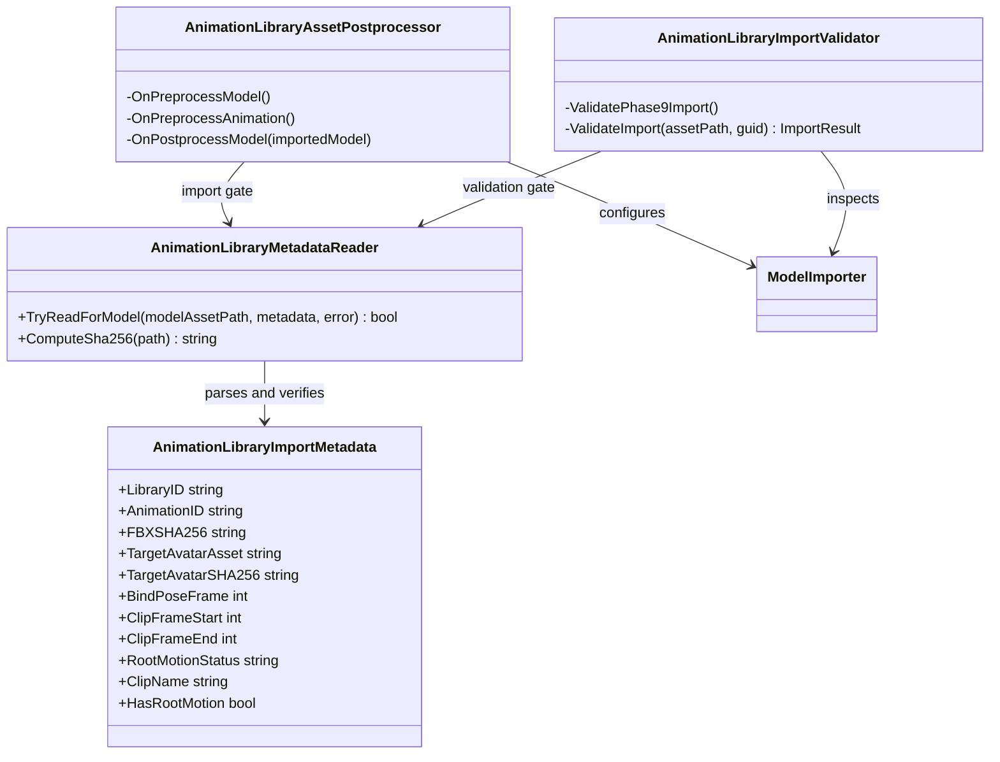

# Animation Library Unity importer

Editor-only boundary that turns a Phase 8 FBX plus its adjacent `.animlib.json` contract into a deterministic Unity animation asset. It is Project S integration code, so it belongs to `Core/Editor` and does not become a reusable runtime module.

Dependencies point only toward Unity Editor APIs and the adjacent metadata contract. Runtime assemblies, gameplay state and Animator controllers do not depend on this tree.

Import flow:

1. `AnimationLibraryMetadataReader` limits processing to the canonical player import root, parses the contract, and rejects an FBX or normalized Avatar whose SHA-256 differs.
2. `AnimationLibraryAssetPostprocessor` applies Humanoid/Avatar, excludes the FBX bind-pose prefix from the clip, and applies root-motion and label policies during the matching importer callbacks. A cold project reimport queues one dependent reimport when Unity processes a clip before its Avatar.
3. `AnimationLibraryImportValidator` reads the expected clip count from the staging manifest, independently checks the imported sub-assets and importer settings, verifies the exact clip range and requires non-constant pose curves in addition to root translation, then writes the Phase 9 receipt consumed by the external pipeline ledger.

The source Avatar is loaded from the contract and is normalized through the same Blender FBX profile as the animation-only exports. Clip semantics are never inferred by the importer; `Probable` and `Unknown` catalog entries remain unverified after a successful technical import.
