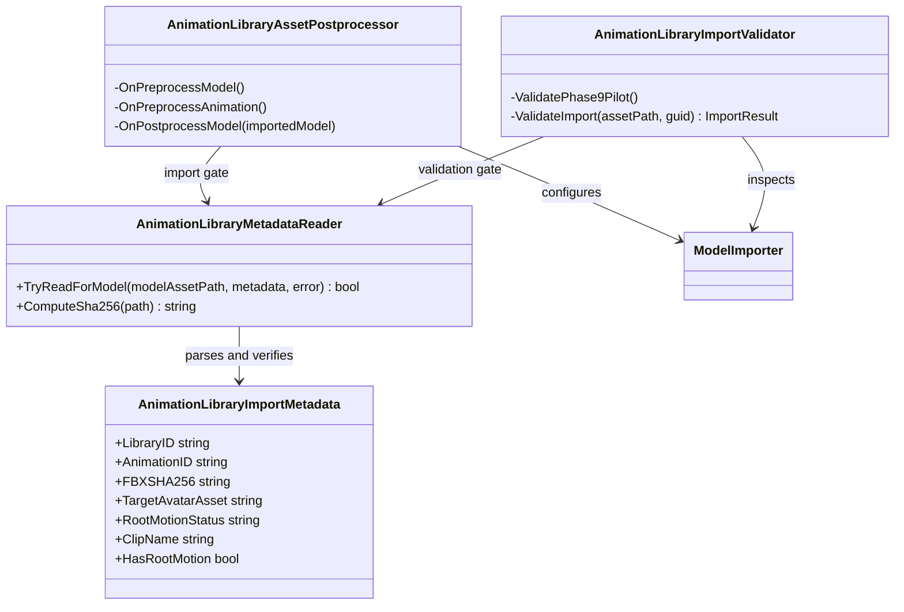

# Animation Library Unity importer

Editor-only boundary that turns a Phase 8 FBX plus its adjacent `.animlib.json` contract into a deterministic Unity animation asset. It is Project S integration code, so it belongs to `Core/Editor` and does not become a reusable runtime module.

Dependencies point only toward Unity Editor APIs and the adjacent metadata contract. Runtime assemblies, gameplay state and Animator controllers do not depend on this tree.

Import flow:

1. `AnimationLibraryMetadataReader` limits processing to the pilot import root, parses the contract and rejects an FBX whose SHA-256 differs.
2. `AnimationLibraryAssetPostprocessor` applies Humanoid/Avatar, clip, root-motion and label policies during the matching importer callbacks.
3. `AnimationLibraryImportValidator` independently reads the imported sub-assets and importer settings, then writes the Phase 9 receipt consumed by the external pipeline ledger.

The source Avatar is loaded from the contract. Clip semantics are never inferred by the importer; `Probable` and `Unknown` catalog entries remain unverified after a successful technical import.
