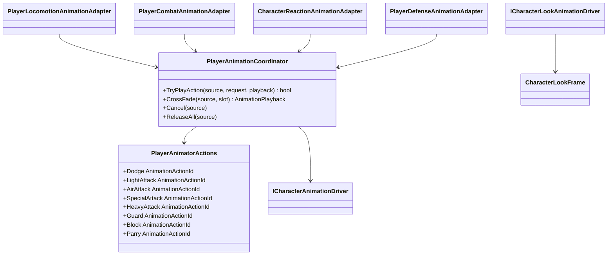

# Player animation orchestration

Project S sends semantic action requests to the reusable animation driver.
Gameplay never calls `Animator.Play` or names a controller state. The
Project-S-specific `XControllerCharacterAnimationDriver` is the only adapter
that knows the restored controller's state paths.

- The coordinator owns finite-action priority, action source and playback speed.
- Normal completion and interruption are distinct: `ReleaseAll` calls the
  driver's non-disruptive `CompleteAction`, while `Cancel` requests a visual
  exit. This keeps action-scoped look policy and layer ownership bounded by the
  gameplay lifecycle.
- It does not own clips, Animator states, transitions or blend durations.
- Dodge uses action ID `1` with forward/backward variants. Ground light attacks
  use action ID `2` and variants `0...2`; air light attacks use action ID `5`
  and variants `0...2`; the named grounded special uses action ID `6`, variant
  `0`; the named grounded heavy uses action ID `7`, variant `0`. Defense uses
  action IDs `10...12` for guard, block and parry.
- The restored `XController` has no semantic action parameters. The adapter
  enters its existing Roll and Attack states with short fixed-time crossfades;
  the existing clips, state hierarchy and exit transitions are unchanged.
  `SpecialAttack` resolves to the existing `Attack/Skill` state and
  `HeavyAttack` resolves to `Attack/BaseAttack4`, without creating controller
  branches.
- Cancellation is explicit. Release only drops source ownership and does not
  force a state change after normal completion.
- Weapon-specific Animator Override Controllers are optional. A loadout without
  an override keeps the base `XController` and its existing clip table.
- `Reaction/Guard`, `Reaction/Block` and `Reaction/Parry` are stable controller
  slots without graph transitions. `PlayerDefenseAnimationAdapter` enters them
  from confirmed gameplay events; release and impact completion explicitly
  return presentation ownership. The `DualSwords` override maps those stable
  slots to the current Frank Humanoid clips, so another weapon can replace the
  clips without changing state names or gameplay code.
- Defense has priority `250`: it overrides locomotion and combat presentation,
  while traversal, reactions and death can interrupt it. `BodyLook` and
  `HeadLook` weights damp to zero during defense clips to avoid additive pose
  distortion, then recover through the existing look controller.
- Targeting supplies local yaw/pitch degrees through `CharacterLookFrame`.
  XController splits that request into slower limited body motion and faster
  residual head motion, with action- and airborne-specific attenuation.
  A small angular dead zone suppresses idle aim noise. The last unambiguous
  yaw side is retained while a target crosses the `+180/-180` rear seam, so
  BodyLook and HeadLook do not alternate between opposite additive poses.
- Reaction and death use the required `Reaction/HitStun`, `HitStun_Back`,
  `HitStun_Left`, `HitStun_Right`, `Knockdown`, `GetUp`, `Airborne`, `Dead_1`
  and `Dead_2` states. Direction names identify the source side relative to the
  target; the original `HitStun` is the front/missing-direction fallback.
  Traversal remains optional: requests
  whose state is absent return an invalid playback instead of breaking composition.
- `XControllerAnimationContract` is the single runtime source of required
  parameter, layer and state names. The editor validator consumes the same
  contract, preventing duplicated strings from drifting apart.
