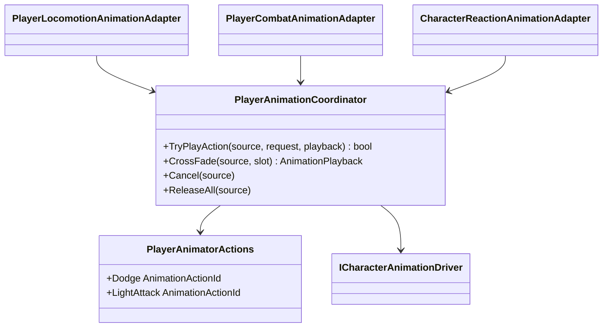

# Player animation orchestration

Project S sends semantic action requests to the reusable animation driver.
Gameplay never calls `Animator.Play` or names a controller state.

- The coordinator owns finite-action priority, action source and playback speed.
- It does not own clips, Animator states, transitions or blend durations.
- Dodge uses action ID `1` with forward/backward variants. The first light
  attack uses action ID `2`.
- Cancellation is explicit. Release only drops source ownership and does not
  force a state change after normal completion.
- Reaction, death and traversal slots are optional today. Unsupported ladder
  presentation prevents ladder action construction, so gameplay cannot enter a
  visually undefined climb state.
