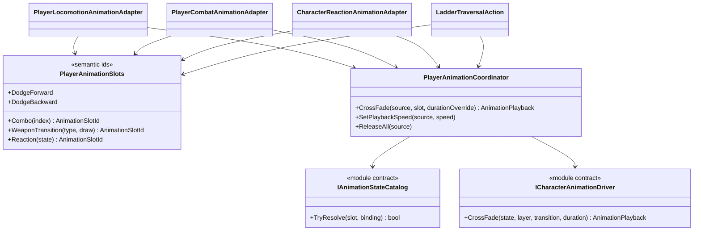

# Player animation orchestration

This tree translates Project S gameplay semantics into the reusable animation
module. Gameplay code never names an Animator state or assumes a layer index.

## Class diagram

## Dependencies and ownership

- `PlayerAnimationSlots` is the only Project S vocabulary for requested poses.
  Adding or replacing an Animator Controller does not change these identifiers.
- `PlayerAnimationCoordinator` owns layer arbitration with the priority
  `Reaction > Traversal > Combat > Locomotion`. Adapters do not compete by
  writing directly to Animator.
- `IAnimationStateCatalog` resolves a semantic slot to a concrete state, layer,
  blend time and fallback duration. Resolution is cached during the character
  scope.
- Locomotion, combat, traversal and reaction adapters own only the translation
  from confirmed gameplay state to a semantic animation request.
- Reaction-specific slots fall back to the general state slot in Project S;
  absent optional reaction presentation does not block damage or state changes.
- Combat and traversal may require a positive presentation duration because
  their current authoring uses it for the temporary action/traversal timeline.
  Combat gameplay windows themselves remain owned by `CombatActionExecutor`.
- Root motion selection remains in combat/traversal gameplay and is not part of
  the animation profile.

## Current authoring

`Player_MecanimAnimationProfile.asset` maps the current player slots to nested
states in `XController.controller`. It contains explicit durations for dodge,
combat, weapon transitions and ladder traversal, including cases where the
state name differs from the clip name.
