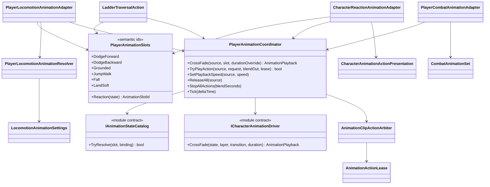

# Player animation orchestration

This tree translates Project S gameplay semantics into the reusable animation
module. Gameplay code never names an Animator state or assumes a layer index.

## Class diagram

## Dependencies and ownership

- `PlayerAnimationSlots` is the only Project S vocabulary for requested poses.
  Adding or replacing an Animator Controller does not change these identifiers.
- `PlayerAnimationCoordinator` is the only Project S entry point for continuous
  states and finite actions. It maps semantic sources to the priority
  `Death > Reaction > Traversal > Combat > Locomotion`. State requests blocked by
  a higher-priority owner are retained, so the newest valid state is restored
  after an interruption. Adapters do not compete by writing directly to Animator.
- Finite actions use module leases. When reaction or death replaces combat, the
  old combat lease becomes stale and its later cleanup cannot stop the replacing
  clip. Disable and scene teardown call one unconditional action reset.
- `IAnimationStateCatalog` resolves a semantic slot to a concrete state, layer,
  blend time and fallback duration. Resolution is cached during the character
  scope.
- Locomotion, traversal and reaction adapters own only the translation
  from confirmed gameplay state to a semantic animation request.
- `PlayerCombatAnimationAdapter` translates a confirmed combat action into an
  authored clip request and claims the `Combat` channel. It has no direct access
  to the Playables driver.
- `PlayerLocomotionAnimationResolver` owns presentation-only phases. It derives
  jump variants, fall and landing severity from `PlayerLocomotionSnapshot`, but
  never changes motor or gameplay state.
- `CharacterReactionAnimationAdapter` first resolves a shared finite action by
  the reaction-specific semantic slot, then by the general reaction-state slot,
  and finally falls back to an optional controller state. Missing presentation
  never blocks damage or reaction gameplay state.
- Combat and traversal require a positive presentation duration because
  their current authoring uses it for the temporary action/traversal timeline.
  Combat gameplay windows themselves remain owned by `CombatActionExecutor`.
- Root motion selection remains in combat/traversal gameplay and is not part of
  the animation profile.

## Current authoring

`Player_MecanimAnimationProfile.asset` maps 18 locomotion and traversal slots to
nested states in `XController.controller`. It contains explicit durations for
dodge and ladder traversal, including cases where the state name differs from
the clip name.

`XController.controller` contains only continuous locomotion, traversal and
additive look presentation. It has no combat state machine and no weapon-switch
layer. State entry, interruption and restoration are owned by
`PlayerAnimationCoordinator`; blend durations are fixed seconds, not normalized
clip time.

`CharacterAnimationActionPresentation` is the common finite-action authoring
record: clip, blend-in/out, playback speed, optional AvatarMask and foot IK.
`CombatAnimationSet` owns loadout-specific records, while `AnimationsData`
can own shared semantic actions such as `Reaction.HitStun`. Neither owns hit
windows, cancel rules, damage or root motion.
