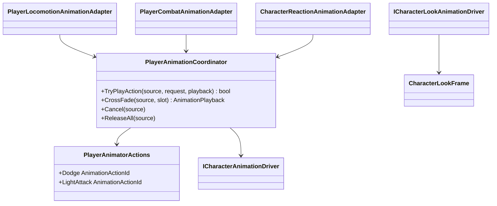

# Player animation orchestration

Project S sends semantic action requests to the reusable animation driver.
Gameplay never calls `Animator.Play` or names a controller state. The
Project-S-specific `XControllerCharacterAnimationDriver` is the only adapter
that knows the restored controller's state paths.

- The coordinator owns finite-action priority, action source and playback speed.
- Normal completion and interruption are distinct: `ReleaseAll` calls the
  driver's non-disruptive `CompleteAction`, while `Cancel` requests a visual
  exit. This keeps action-scoped look policy and layer ownership bounded by the
  gameplay lifecycle.
- It does not own clips, Animator states, transitions or blend durations.
- Dodge uses action ID `1` with forward/backward variants. The first light
  attack uses action ID `2`.
- The restored `XController` has no semantic action parameters. The adapter
  enters its existing Roll and Attack states with short fixed-time crossfades;
  the existing clips, state hierarchy and exit transitions are unchanged.
- Cancellation is explicit. Release only drops source ownership and does not
  force a state change after normal completion.
- Weapon-specific Animator Override Controllers are optional. A loadout without
  an override keeps the base `XController` and its existing clip table.
- Targeting supplies local yaw/pitch degrees through `CharacterLookFrame`.
  XController splits that request into slower limited body motion and faster
  residual head motion, with action- and airborne-specific attenuation.
- Reaction, death and traversal slots are optional today. Requests whose states
  are absent from the current controller return an invalid playback instead of
  breaking composition.
