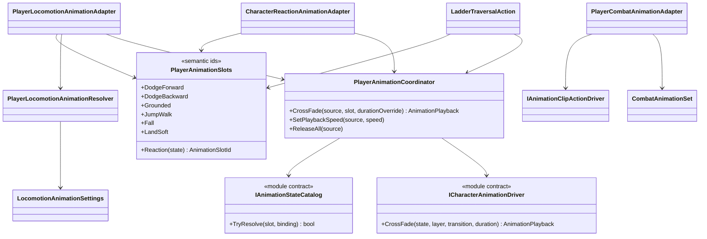

# Player animation orchestration

This tree translates Project S gameplay semantics into the reusable animation
module. Gameplay code never names an Animator state or assumes a layer index.

## Class diagram

## Dependencies and ownership

- `PlayerAnimationSlots` is the only Project S vocabulary for requested poses.
  Adding or replacing an Animator Controller does not change these identifiers.
- `PlayerAnimationCoordinator` owns controller-state arbitration with the priority
  `Reaction > Traversal > Locomotion`. Requests blocked by
  a higher-priority owner are retained, so the newest valid state is restored
  after an interruption. Adapters do not compete by writing directly to Animator.
- `IAnimationStateCatalog` resolves a semantic slot to a concrete state, layer,
  blend time and fallback duration. Resolution is cached during the character
  scope.
- Locomotion, traversal and reaction adapters own only the translation
  from confirmed gameplay state to a semantic animation request.
- `PlayerCombatAnimationAdapter` is deliberately outside controller-state
  arbitration. It translates the confirmed combat action into an authored clip
  request for the Playables action lane. Combat interruption stops that lane;
  gameplay state never waits for Animator state inspection.
- `PlayerLocomotionAnimationResolver` owns presentation-only phases. It derives
  jump variants, fall and landing severity from `PlayerLocomotionSnapshot`, but
  never changes motor or gameplay state.
- Reaction-specific slots fall back to the general state slot in Project S;
  absent optional reaction presentation does not block damage or state changes.
- Combat and traversal require a positive presentation duration because
  their current authoring uses it for the temporary action/traversal timeline.
  Combat gameplay windows themselves remain owned by `CombatActionExecutor`.
- Root motion selection remains in combat/traversal gameplay and is not part of
  the animation profile.

## Current authoring

`Player_MecanimAnimationProfile.asset` maps 18 locomotion and traversal slots to
nested states in `XController.controller`. It contains explicit durations for
dodge and ladder traversal, including cases where the state name differs from
the clip name.

`XController.controller` contains only continuous locomotion, traversal and
additive look presentation. It has no combat state machine and no weapon-switch
layer. State entry, interruption and restoration are owned by
`PlayerAnimationCoordinator`; blend durations are fixed seconds, not normalized
clip time.

`CombatAnimationSet` assets own combo, named-action and draw/sheathe clip
presentation, including blend-in, blend-out, playback speed, optional AvatarMask
and foot IK. They do not own hit windows, cancel rules, damage or root motion.
