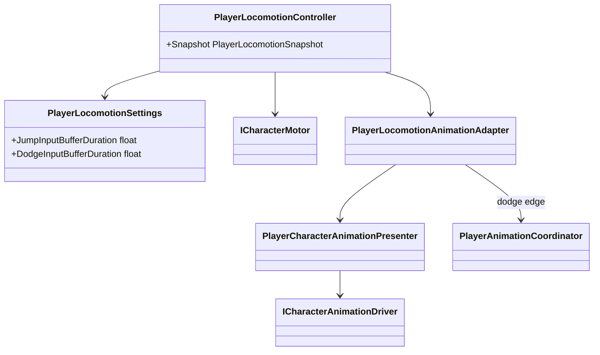

# Player locomotion and animation presentation

The motor and locomotion state machine own movement. Animation observes their
immutable snapshot.

- `PlayerLocomotionController` owns `Idle`, `Run`, `Jump`, `Fall` and `Dodge`.
- `PlayerCharacterAnimationPresenter` continuously writes planar speed in world
  units, normalized speed, vertical speed, grounded state, gait and locomotion
  mode. The current Mecanim blend tree uses planar speed thresholds `0/3/5/10`
  for idle/walk/run/sprint.
- The Animator Controller derives jump/fall/landing presentation from those
  values. There is no presentation-only locomotion state machine or animation
  settings ScriptableObject.
- `PlayerLocomotionAnimationAdapter` sends a finite semantic action only on the
  rising edge of dodge and releases ownership on exit.
- A dodge request remains owned by `PlayerLocomotionController` for the short
  duration configured by `DodgeSettings`. This lets a press immediately before
  an attack cancel window execute as soon as the window opens; an early or
  disabled request expires and cannot leak into a later action. Its lifetime is
  measured in unscaled time, matching combat input and preventing hit stop from
  extending the player's real input window; locomotion simulation remains
  scaled.
- Jump press uses the character's existing pre-grounded input window as its
  unscaled buffer duration. A press near the end of a combat lockout is retried
  when movement policy allows jumping again; releasing before acceptance still
  produces the existing short-jump path instead of cancelling the intent.
  Simultaneous accepted dodge keeps priority and clears the jump request.
- Dodge displacement is motor-owned impulse/duration movement; Animator root
  motion is disabled.
- Dodge invulnerability is a normalized gameplay window from `DodgeSettings`.
  `PlayerDodgeAction` owns a disposable immunity lease and releases it on the
  authored window end, interruption, disable and normal dodge completion.
- Damage immunity uses shared leases, so a dodge window and an overlapping
  combat-action window cannot clear each other's ownership.
- Swimming and climbing enum values remain reserved, but no corresponding
  animation states are implemented yet.
