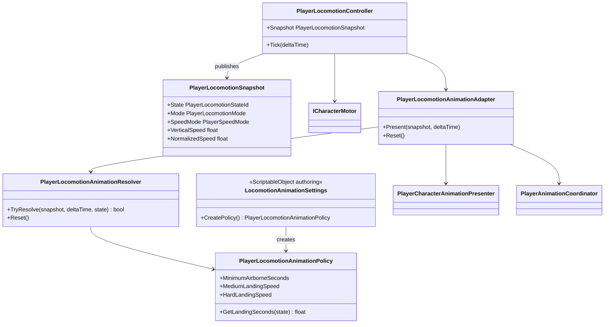

# Player locomotion and animation presentation

Gameplay locomotion and visual locomotion are related but have different state
owners. The motor and locomotion state machine own movement. The animation
resolver observes their immutable snapshot and owns only presentation phases.

## Class diagram

## State ownership

- `PlayerLocomotionController` chooses `Idle`, `Run`, `Jump`, `Fall` and `Dodge`
  from motor state. These states drive movement and remain authoritative.
- `PlayerLocomotionAnimationResolver` derives `Grounded`, jump gait variants,
  `Fall`, three landing severities and dodge direction. It cannot move the
  character or change gameplay state.
- Downward impact speed is accumulated while airborne. A minimum airborne time
  prevents steps and short ground-contact noise from triggering a landing pose.
- Landing poses have a short minimum presentation window and can then be
  interrupted by movement. Jump, fall and dodge interrupt landing immediately.
- `PlayerLocomotionAnimationAdapter` writes blend-tree parameters before
  requesting a state change, so the destination pose sees current values on its
  first evaluation.
- `PlayerAnimationCoordinator` retains a lower-priority locomotion request while
  combat, traversal or reaction owns the layer. Releasing the interruption
  restores the newest phase rather than a stale pre-interruption state.

## Character configuration

`LocomotionAnimationSettings` belongs to `CharacterFeatureSet`, so different
characters can tune landing thresholds and presentation hold times without a
different controller implementation. Concrete clips, layers, state paths and
fixed-time blend seconds remain in `MecanimCharacterAnimationProfile`.
