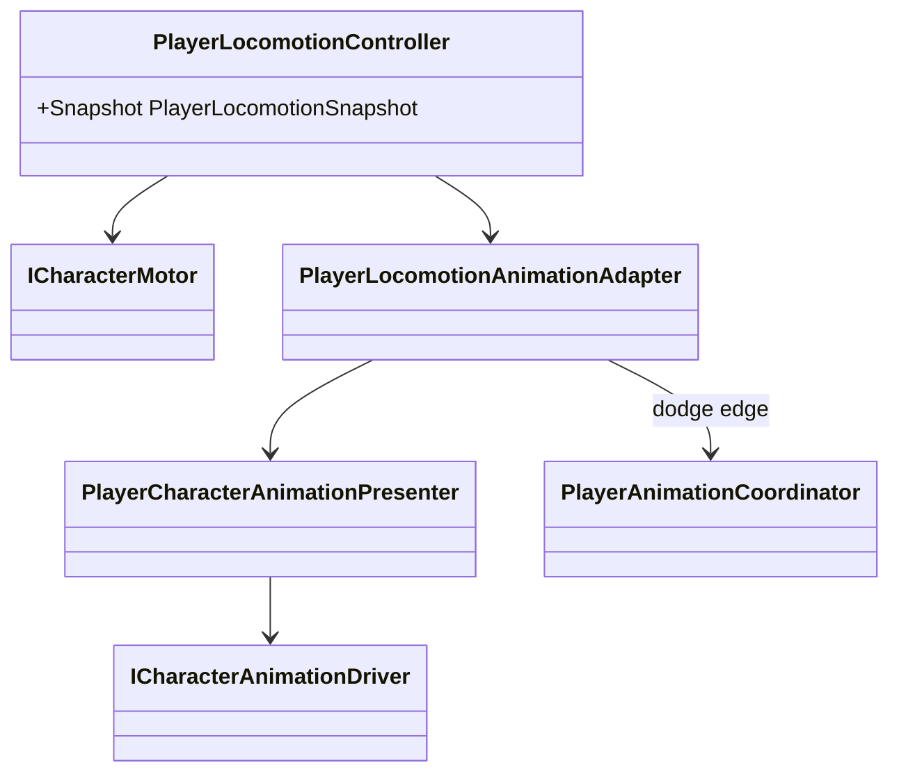

# Player locomotion and animation presentation

The motor and locomotion state machine own movement. Animation observes their
immutable snapshot.

- `PlayerLocomotionController` owns `Idle`, `Run`, `Jump`, `Fall` and `Dodge`.
- `PlayerCharacterAnimationPresenter` continuously writes planar speed in world
  units, normalized speed, vertical speed, grounded state, gait and locomotion
  mode. The current Mecanim blend tree uses planar speed thresholds `0/3/5/10`
  for idle/walk/run/sprint.
- The Animator Controller derives jump/fall/landing presentation from those
  values. There is no presentation-only locomotion state machine or animation
  settings ScriptableObject.
- `PlayerLocomotionAnimationAdapter` sends a finite semantic action only on the
  rising edge of dodge and releases ownership on exit.
- Dodge displacement is motor-owned impulse/duration movement; Animator root
  motion is disabled.
- Swimming and climbing enum values remain reserved, but no corresponding
  animation states are implemented yet.
