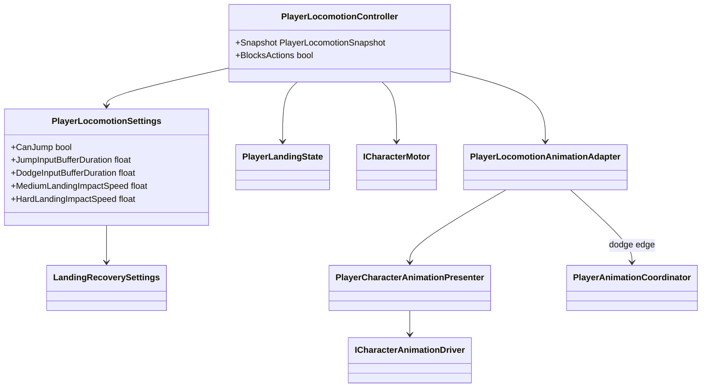

# Player locomotion and animation presentation

The motor and locomotion state machine own movement. Animation observes their
immutable snapshot.

- `PlayerLocomotionController` owns `Idle`, `Run`, `Jump`, `Fall`, `Dodge` and
  impact-based `Landing` recovery.
- `PlayerCharacterAnimationPresenter` continuously writes planar speed in world
  units, normalized speed, vertical speed, grounded state, gait and locomotion
  mode. The current Mecanim blend tree uses planar speed thresholds `0/3/5/10`
  for idle/walk/run/sprint.
- The Animator Controller derives jump/fall/landing presentation from those
  values. There is no presentation-only locomotion state machine or animation
  settings ScriptableObject.
- `PlayerLocomotionAnimationAdapter` sends a finite semantic action only on the
  rising edge of dodge and releases ownership on exit.
- A dodge request remains owned by `PlayerLocomotionController` for the short
  duration configured by `DodgeSettings`. This lets a press immediately before
  an attack cancel window execute as soon as the window opens; an early or
  disabled request expires and cannot leak into a later action. Its lifetime is
  measured in unscaled time, matching combat input and preventing hit stop from
  extending the player's real input window; locomotion simulation remains
  scaled.
- Jump press uses the character's existing pre-grounded input window as its
  unscaled buffer duration. A press near the end of a combat lockout is retried
  when movement policy allows jumping again; releasing before acceptance still
  produces the existing short-jump path instead of cancelling the intent.
  Simultaneous accepted dodge keeps priority and clears the jump request.
- Ground jump startup publishes a separate accepted-intent edge before its
  authored anticipation delay. Combat uses that edge for same-frame arbitration;
  the reservation remains visible in the locomotion snapshot until the existing
  `JumpAccepted` edge confirms motor takeoff. A bounded `0.10 s` scaled timeout
  releases the reservation and jump input if physics rejects the request.
- Dodge acceptance has the same explicit simulation boundary. The locomotion
  snapshot exposes `IsDodgeStarting` from acceptance until the next character
  simulation step enters the custom dodge mode. Combat, weapon switching and
  Guard cannot claim that gap while the motor still reports `Walking`.
- Dodge displacement is motor-owned impulse/duration movement; Animator root
  motion is disabled.
- When dodge finishes after leaving the ground, locomotion follows the motor
  directly into `Jump` for upward velocity or `Fall` for downward velocity.
  Buffered input cannot leave the state machine stuck in `Dodge`.
- Dodge invulnerability is a normalized gameplay window from `DodgeSettings`.
  `PlayerDodgeAction` owns a disposable immunity lease and releases it on the
  authored window end, reaction interruption, disable and normal dodge
  completion. A confirmed hit outside that window stops dodge movement before
  reaction knockback is applied.
- Damage immunity uses shared leases, so a dodge window and an overlapping
  combat-action window cannot clear each other's ownership.
- `CharacterMotor` forwards confirmed landing impact speed. `Soft` landing is
  non-blocking; current `Medium` (`> 7 m/s`) and `Hard` (`> 10 m/s`) landings
  lock translation/actions for `0.64s` and `0.95s`. The motor removes residual
  planar velocity, while animation receives an immediate movement-parameter
  lock so `LandMedium`/`LandHard` can reach their authored exit phase.
- Landing recovery uses scaled gameplay time, is cancelled when ground is lost,
  and is cleared by reaction interruption, disable and disposal.
- Swimming and climbing enum values remain reserved, but no corresponding
  animation states are implemented yet.
