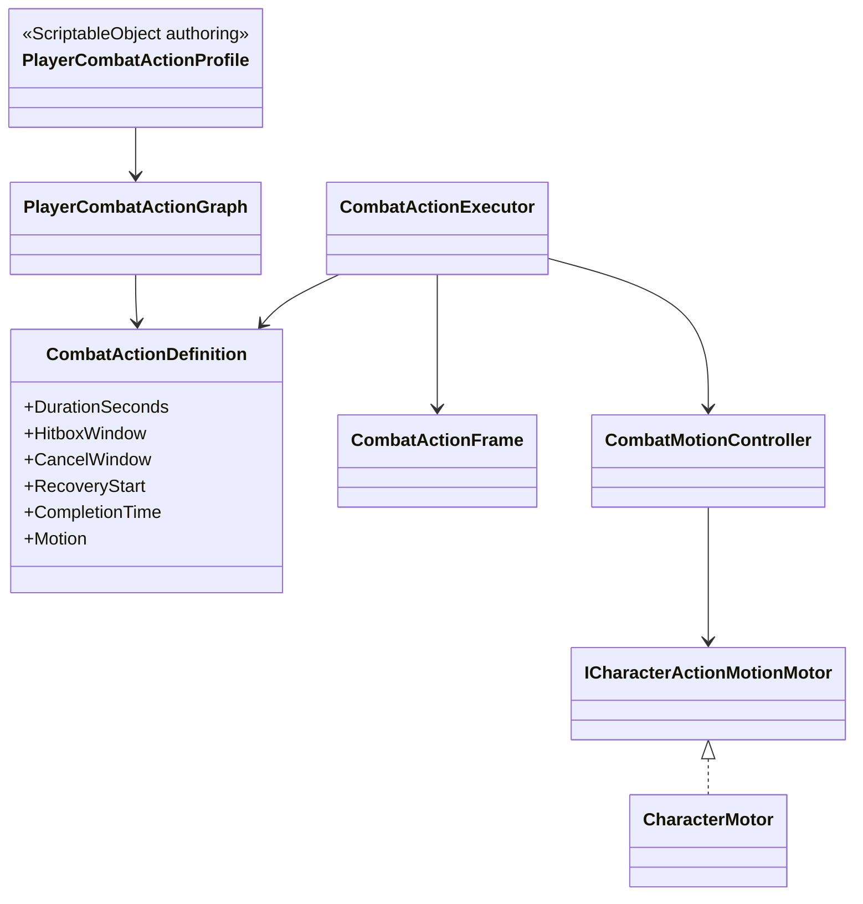

# Player combat action timeline

Combat timing is independent from animation presentation.

- `DurationSeconds` is the full gameplay time basis. Normalized hit, cancel,
  recovery, invulnerability and motion windows are evaluated against it.
- `CombatActionExecutor` owns elapsed time and cleanup. It does not read
  Animator state or clip length.
- `CombatMotionController` creates collision-safe velocity intents from an
  authored distance and normalized window. Animation-derived trajectory assets
  are not used.
- `CharacterMotor` and `CharacterMovement` remain the only authorities for
  position, collision, slopes and grounding.
- The current profile contains one grounded unarmed action and one
  `attack.light` entry. Combo transitions, air actions and skills are deferred.
