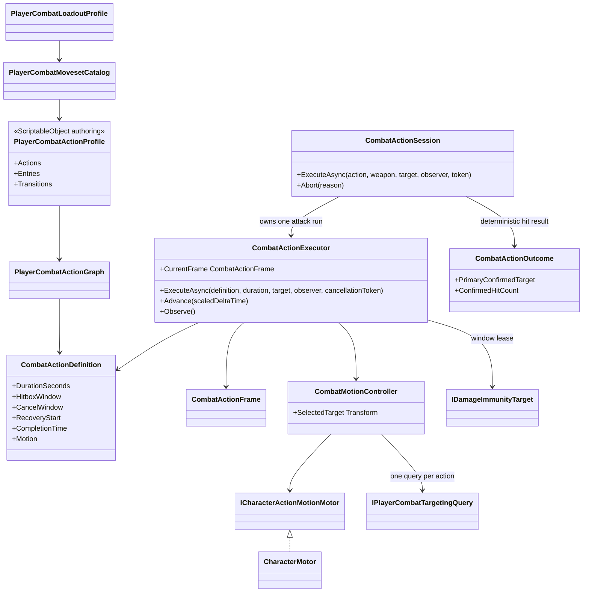

# Player combat action timeline

Combat timing is independent from animation presentation.

- `DurationSeconds` is the full gameplay time basis. Normalized hit, cancel,
  recovery, invulnerability and motion windows are evaluated against it.
- `CombatActionExecutor` owns elapsed time and cleanup, but does not poll Unity
  time or schedule its own frame loop. `PlayerActorController` advances combat
  exactly once before locomotion command resolution, then resolves combat
  commands after locomotion has had the opportunity to accept a dodge against
  the current authored cancel policy.
  The executor does not read Animator state or clip length.
- A tick is split deliberately: `Advance` first creates the authoritative
  `CombatActionFrame`, input callbacks captured since the previous tick are then
  consumed against that frame, and `Observe` finally resolves recovery,
  transition, commit and completion. This prevents callback/`UniTask` scheduling
  order from changing combat results.
- `CombatActionSession` surrounds one graph action with its execution id,
  confirmed outcome and hitbox lifecycle. The executor remains the lower-level
  timeline/motion mechanism; session end reason explains why the action stopped.
- Multi-target actions select one confirmed successor target deterministically.
  A target already selected by combat motion/lock-on wins when it was actually
  hit; otherwise the closest confirmed target wins with a stable instance-id
  tie-break. Physics overlap order therefore cannot redirect air chase.
- `Allow Jump`, `Allow Dodge` and `Allow Guard` are action policies, not
  free-form escape flags. They become effective only while the authored
  `CancelWindow` is open. Startup, hit-confirm and committed recovery therefore
  cannot be bypassed accidentally.
- Startup is transactional: if a motion or immunity adapter fails while an
  execution is beginning, `Abort` rolls the partial state back and leaves no
  stale motion intent or active execution id.
- `PlayerCombatActionProfile.OnValidate` builds the complete immutable graph in
  the Editor, so duplicate ids, invalid transitions, timelines and impact data
  fail at authoring time instead of first appearing during gameplay composition.
- Graph compilation also walks every entry and transition. An orphaned action
  that cannot be reached from any command entry is rejected instead of remaining
  as silent, untestable authoring data.
- An action profile is weapon-specific and owns no runtime state, input-buffer
  policy or draw/sheathe timing. `PlayerCombatLoadoutProfile` owns those shared
  policies and maps each weapon to its profile and optional Animator override.
- Standard `hit.launcher` and `hit.slam` ids validate the sign of vertical
  knockback. Custom reaction ids remain open and are classified by the target
  reaction system at runtime.
- Hit filtering is once per target and action by default. A multi-hit action can
  opt into a bounded repeat count and scaled-time interval; hit stop freezes that
  interval instead of generating extra contacts while gameplay time is paused.
- Each invulnerability window owns a disposable lease. Overlapping combat and
  dodge windows compose without one action clearing another owner's immunity.
- `CombatMotionController` creates collision-safe velocity intents from an
  authored distance and normalized window. Animation-derived trajectory assets
  are not used. Ground attacks may acquire one soft-assist target inside an
  authored cone; this does not mutate hard lock-on or camera state.
- Target-height tracking composes with `MinimumVelocity`: correction may follow
  an ascending target but cannot exceed the authored falling-speed limit.
  `OverrideVelocity` remains an exact command and is rejected when combined
  with tracking, preventing a profile from silently replacing a slam velocity.
- Combat facing and planar approach use the target aim point, while vertical
  tracking aligns actor roots. `TargetHeightOffset` therefore describes an
  intentional root/pivot difference instead of accidentally lifting an actor
  to a humanoid target's head or chest aim marker.
- `CharacterMotor` and `CharacterMovement` remain the only authorities for
  position, collision, slopes and grounding.
- The current Dual Swords profile contains independent grounded and airborne
  `attack.light` branches, grounded named `attack.heavy` and `skill.special`
  actions, a direct grounded launcher entry, and a hit-confirmed
  `attack.launcher -> movement.air-chase` route. Every ground-light step exposes
  the same heavy and hit-confirmed launcher cancels; environment-specific
  entries share semantic commands without device checks.
- The first two ground-light nodes open their chain and combat-cancel windows
  at the exact end of the authored hitbox window. A buffered successor may be
  captured earlier, but it cannot close the source execution before its final
  active frame has been sampled. This keeps rapid input responsive without
  shortening a strike's effective contact window.
- Ground motion stopping distance is authored per clip reach. The second Dual
  Swords light step uses `0.70 m`; sharing the longer steps' `0.80 m` boundary
  suppresses its approach before the shorter transverse swing can make contact.
- Air actions use motor-owned `MinimumVelocity` and planar intents for a bounded
  air hang. Animator root motion never becomes position authority.
- The Dual Swords slam preserves its authored wind-up: exact downward velocity
  starts at normalized `0.08`, shortly before the `0.11` contact window. This
  retains the clip's anticipation before the descent commits. The finisher is
  valid in both airborne and grounded environments: it must start through the
  airborne combo edge, but landing does not cancel its impact phase before the
  blades reach the target.
