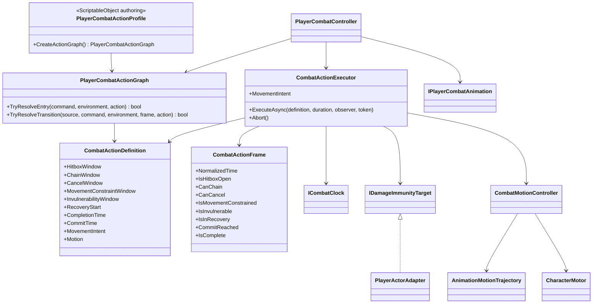

# Player combat action timeline

This tree owns the timing of player combat actions independently from the
temporary animation clips. Animation selects and blends a pose; the action
timeline decides when gameplay windows open, when an action commits and when it
is complete.

## Class diagram

## Dependency and ownership rules

- `PlayerCombatController` resolves a semantic command through the action graph. It
  does not count animation frames and does not read Animator state.
- `CombatActionExecutor` is the sole owner of elapsed action time. It evaluates
  inclusive normalized windows using the injected combat clock.
- `IPlayerCombatAnimation` returns presentation duration only. Clip names and
  Animator states are not action identifiers and may be replaced freely.
- `PlayerCombatActionGraph` contains immutable runtime definitions and transition rules.
  `PlayerCombatActionProfile` is optional immutable authoring data that creates
  that graph at composition time.
- Animation-authored motion is stored as an optional trajectory on the action's
  combat-motion definition. `CombatMotionController` evaluates the displacement
  between the previous and current action times and queues that local delta on
  the motor; the Animator never moves the actor directly. This preserves motion
  when a slow frame crosses several baked samples.
- `CharacterMotor` and `CharacterMovement` remain the only authorities for
  velocity, collision, grounding and slopes. The motor consumes each queued
  displacement once through the normal collision sweep and clears the temporary
  planar velocity on the next simulation step. Interruption or cancellation
  clears the active continuous intent in `CombatActionExecutor` cleanup.
- Hitbox state is derived from the current action frame. The weapon rig remains
  the owner of the physical hitbox.
- Movement constraints may apply to the full action or to a configured window.
  Outside that window the executor exposes unrestricted movement intent.
- Invulnerability is an explicit action window evaluated by the executor;
  `Health` remains the owner of whether incoming damage is accepted.
- Input buffering remains a separate concern. Project S adapts the reusable
  `ModularInput.InputBuffer<TAction>` and consumes a command only when the graph
  resolves it through the current chain/cancel window.

## Current Player authoring

`Assets/_Game/Settings/Combat/Player/PlayerCombatActionProfile.asset` is assigned
to the Player prefab. It currently defines four grounded combo actions, four
airborne combo actions, grounded/airborne `skill.special` variants, and their
entry, chain and cancel rules.

The input buffer holds four commands and prioritizes `skill.special`. Action
definitions own their normalized hit, chain, cancel, recovery and combat-motion
windows. Current damage, timing and motion values are initial tuning data. Both
branches temporarily reuse the four available combo clips, so replacing FBX,
clips or the Animator Controller does not require changing the gameplay graph.

The PSO2 NGS actions keep their original presentation clips. The Playables graph
filters the Generic motion-root pose in memory, while matching
`AnimationMotionTrajectory` assets preserve authored displacement for gameplay.
Actions without a usable trajectory keep the existing distance-based motor
motion as a fallback.

This tree intentionally remains in `_App/Core`: DMC-like cancel semantics are
still game-specific. Only a stable, project-neutral timeline should later be
extracted into `_App/Modules`.
