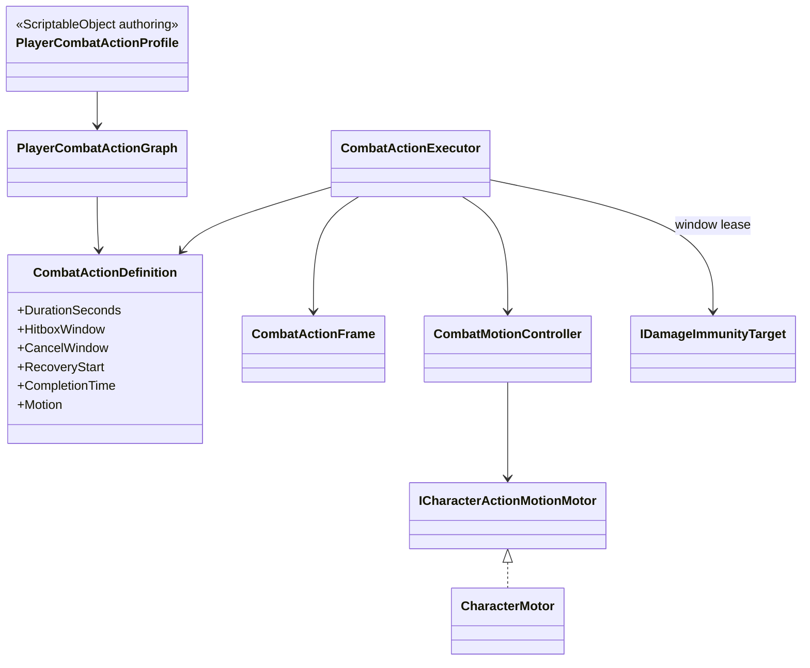

# Player combat action timeline

Combat timing is independent from animation presentation.

- `DurationSeconds` is the full gameplay time basis. Normalized hit, cancel,
  recovery, invulnerability and motion windows are evaluated against it.
- `CombatActionExecutor` owns elapsed time and cleanup. It does not read
  Animator state or clip length.
- Each invulnerability window owns a disposable lease. Overlapping combat and
  dodge windows compose without one action clearing another owner's immunity.
- `CombatMotionController` creates collision-safe velocity intents from an
  authored distance and normalized window. Animation-derived trajectory assets
  are not used.
- `CharacterMotor` and `CharacterMovement` remain the only authorities for
  position, collision, slopes and grounding.
- The current profile contains independent grounded and airborne
  `attack.light` branches, grounded named `attack.heavy` and `skill.special`
  actions, and a hit-confirmed `attack.launcher -> movement.air-chase` route.
  Environment-specific entries share semantic commands without device checks.
- Air actions use motor-owned `MinimumVelocity` and planar intents for a bounded
  air hang. Animator root motion never becomes position authority.
