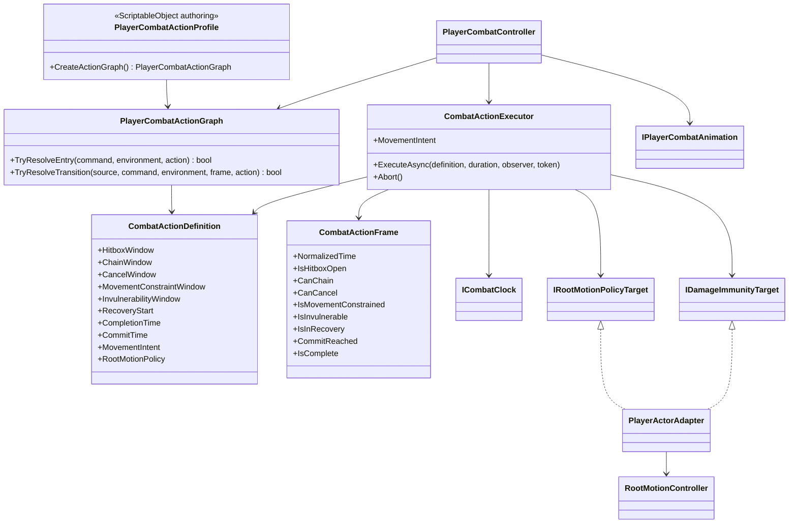

# Player combat action timeline

This tree owns the timing of player combat actions independently from the
temporary animation clips. Animation selects and blends a pose; the action
timeline decides when gameplay windows open, when an action commits and when it
is complete.

## Class diagram

## Dependency and ownership rules

- `PlayerCombatController` resolves a semantic command through the action graph. It
  does not count animation frames and does not read Animator state.
- `CombatActionExecutor` is the sole owner of elapsed action time. It evaluates
  inclusive normalized windows using the injected combat clock.
- `IPlayerCombatAnimation` returns presentation duration only. Clip names and
  Animator states are not action identifiers and may be replaced freely.
- `PlayerCombatActionGraph` contains immutable runtime definitions and transition rules.
  `PlayerCombatActionProfile` is optional immutable authoring data that creates
  that graph at composition time.
- Root motion is selected per action and the previous policy is restored on
  completion, interruption, cancellation and disable.
- Hitbox state is derived from the current action frame. The weapon rig remains
  the owner of the physical hitbox.
- Movement constraints may apply to the full action or to a configured window.
  Outside that window the executor exposes unrestricted movement intent.
- Invulnerability is an explicit action window evaluated by the executor;
  `Health` remains the owner of whether incoming damage is accepted.
- Input buffering remains a separate concern. Project S adapts the reusable
  `ModularInput.InputBuffer<TAction>` and consumes a command only when the graph
  resolves it through the current chain/cancel window.

## Temporary animation policy

The current clips use prototype defaults matching the previous behavior:

- hitbox: `0.20 .. 0.55`;
- combo/cancel: `0.50 .. 0.75`;
- attack completion: `0.75`;
- weapon commit and completion: `0.50`;
- special skill cooldown: `1.25s`;
- root motion: `Ignore`.
- movement constraints: full action;
- invulnerability: disabled.

These values are normalized and are not stored in animation assets. Assign a
`PlayerCombatActionProfile` when tuning begins; replacing FBX, clips or the
Animator Controller does not require changes to gameplay code.

This tree intentionally remains in `_App/Core`: DMC-like cancel semantics are
still game-specific. Only a stable, project-neutral timeline should later be
extracted into `_App/Modules`.
