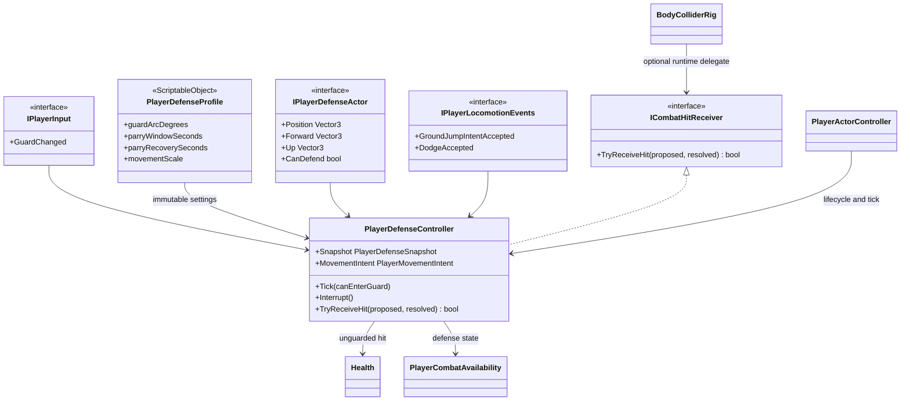

# Player defense

This tree owns the Player guard decision. It is gameplay code: Animator, VFX,
audio and UI may observe its state and confirmed outcomes but cannot decide
whether a hit was blocked or parried.

- `Guard` is a semantic Player action. The current asset binds it to keyboard
  `F` and gamepad `Left Trigger`; gameplay never reads either device directly.
- `PlayerDefenseController` is the only owner of guard hold, parry timing and
  directional admission. It uses the shared unscaled combat clock, so hit stop
  cannot extend a real-time parry window.
- A fresh admissible guard entry opens one `0.12 s` parry opportunity. Its first
  confirmed parry consumes the opportunity; releasing and pressing again cannot
  reopen it before the configured `0.35 s` recovery.
- Direction is evaluated in the actor's current up plane. A missing source
  falls back to the confirmed hit direction; an ambiguous zero vector is not
  treated as a guarded hit.
- A guarded hit remains a confirmed contact and resolves to `Blocked` or
  `Parried`, but carries zero damage, stagger, knockback and reaction. The
  original hit-stop request is preserved for presentation feedback.
- An unguarded or rear hit is delegated to `Health` unchanged. `Health` remains
  a temporary vitality owner and has no knowledge of guard rules.
- While guarding, translation is scaled to `0.35`, facing remains fixed for
  strafe movement, and jump/dodge stay admissible. An accepted jump or dodge
  exits guard in the same simulation tick.
- Starting guard interrupts an active attack and clears pending combat input.
  Attacks and weapon switching cannot start or buffer while guard is active.
- `BodyColliderRig` owns exactly one optional runtime hit receiver. Defense
  attaches on enable and detaches on disable, so scene reload and VContainer
  scope disposal cannot leave a stale delegate.
