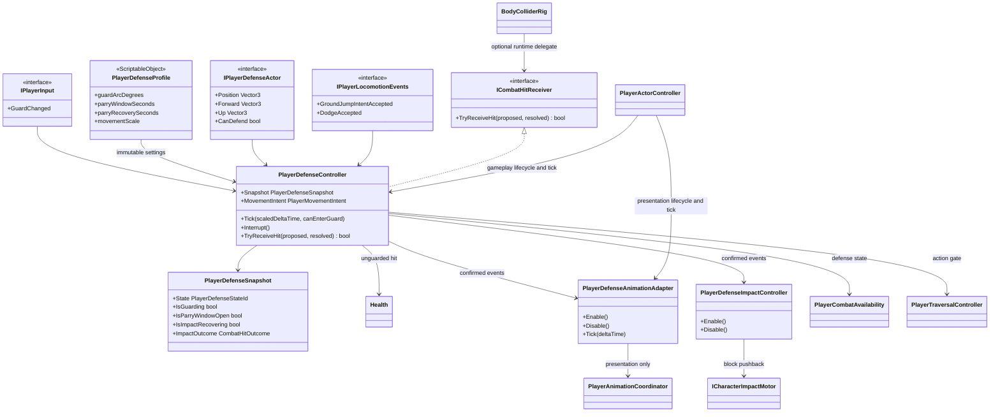

# Player defense

This tree owns the Player guard decision. It is gameplay code: Animator, VFX,
audio and UI may observe its state and confirmed outcomes but cannot decide
whether a hit was blocked or parried.

- `Guard` is a semantic Player action. The current asset binds it to keyboard
  `F` and gamepad `Left Trigger`; gameplay never reads either device directly.
- `PlayerDefenseController` is the only owner of guard hold, parry timing and
  directional admission. It uses the shared unscaled combat clock, so hit stop
  cannot extend a real-time parry window.
- A fresh admissible guard entry opens one `0.12 s` parry opportunity. Its first
  confirmed parry consumes the opportunity; releasing and pressing again cannot
  reopen it before the configured `0.35 s` recovery.
- Direction is evaluated in the actor's current up plane. A missing source
  falls back to the confirmed hit direction; an ambiguous zero vector is not
  treated as a guarded hit.
- A guarded hit remains a confirmed contact and resolves to `Blocked` or
  `Parried`, but carries zero damage, stagger, knockback and reaction. The
  original hit-stop request remains in the result as fallback metadata;
  `CombatFeedbackSettings` can replace it per defensive outcome without
  changing the gameplay decision.
- A confirmed block produces one authored `1.75 m/s` planar pushback through
  `PlayerDefenseImpactController`. The adapter derives an away direction from
  the accepted hit and submits velocity to `ICharacterImpactMotor`; it never
  writes the Transform or owns collision. A successful parry keeps the defender
  planted while the existing source-side recoil moves and staggers the attacker.
- A block opens a `0.50 s` scaled recovery and a parry opens a `1.50 s` scaled
  recovery, both owned by `PlayerDefenseController` and matched to their full
  Humanoid presentation clips. Movement and new actions stay locked even if
  Guard is released immediately; hit stop freezes recovery instead of consuming
  it. Commands may remain buffered after release and resolve when recovery ends.
  A new confirmed defense replaces both the gameplay outcome and presentation
  timeline, preventing repeated impacts from drifting apart.
  The same gate rejects traversal entry, so a climb cannot bypass guard or the
  short block recovery.
- `PlayerDefenseSnapshot.State` is exclusive: impact recovery takes precedence
  over the sustained guard pose. `IsGuarding` separately preserves whether the
  guard is still held, so presentation and UI never need to infer two competing
  primary states from `State=Guarding` plus a recovery flag.
- An unguarded or rear hit is delegated to `Health` unchanged. `Health` remains
  a temporary vitality owner and has no knowledge of guard rules.
- While guarding, translation is scaled to `0.35`, facing remains fixed for
  strafe movement, and jump/dodge stay admissible. An accepted jump or dodge
  exits guard in the same simulation tick.
- Guard entered from `Ready` wins same-frame arbitration and clears pending
  combat input. During an attack it can enter only when that action explicitly
  enables `Allow Guard` and its authored `CancelWindow` is open; startup and
  committed recovery remain protected. Attacks and weapon switching cannot
  start or buffer while guard is active.
- `BodyColliderRig` owns exactly one optional runtime hit receiver. Defense
  attaches on enable and detaches on disable, so scene reload and VContainer
  scope disposal cannot leave a stale delegate.
- `PlayerDefenseAnimationAdapter` observes `GuardStarted`, `GuardEnded` and
  confirmed defense results. It cannot decide whether defense succeeded and
  never changes health, combat phase or locomotion state.
- An authored attack-to-guard cancel releases Combat animation ownership without
  first crossfading to locomotion. The subsequent Defense request therefore
  produces one direct `Attack -> Guard` transition in the same simulation tick.
- A block or parry presentation is allowed to finish even if guard is released
  during the clip. Holding guard returns to the final guard pose; releasing it
  returns to locomotion after the impact clip completes. Presentation time is
  scaled, so hit stop freezes the visual without extending the unscaled parry
  window.
