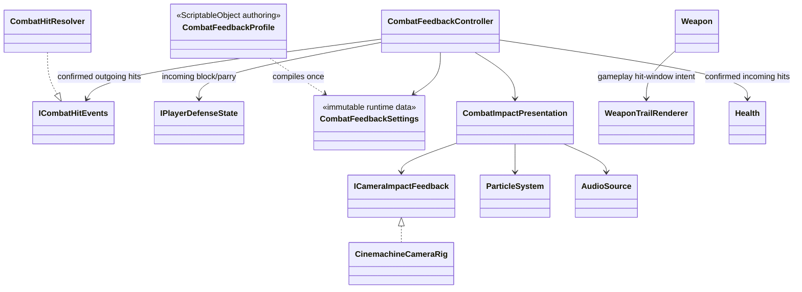

# Combat feedback

This tree renders confirmed combat results without owning damage, reactions or
combat transitions.

- `CombatHitResult` is the only trigger. A hitbox overlap, Animator state or
  Animation Event cannot produce feedback before gameplay confirms the hit.
- `CombatFeedbackController` filters outgoing events to the local actor and also
  observes incoming `Health.Damaged` and `IPlayerDefenseState.Defended` events.
  It owns subscriptions only; it does not change damage, hit stop, poise or
  reaction state.
- `CombatFeedbackProfile` resolves `Blocked` and `Parried` before reaction ids,
  giving defense outcomes distinct camera strength, particles, optional audio
  and hit-stop overrides. Damaging hits still use open reaction-id overrides;
  unknown ids use one explicit fallback. The profile compiles to immutable
  `CombatFeedbackSettings` during VContainer composition.
- `CombatImpactPresentation` owns one world-space particle emitter and a bounded
  pool of four `AudioSource` instances for the gameplay scope. Repeated impacts
  do not instantiate or destroy transient GameObjects.
- `CinemachineCameraRig` is the Cinemachine adapter. It owns the runtime impulse
  source/listener and uses the largest overlapping impulse, preventing rapid
  multi-hit attacks from stacking into uncontrolled camera displacement.
- Hit stop remains a separate gameplay-time concern. The same immutable
  definition may author an outcome-specific override, but only
  `CombatHitStopController` requests time scale; particles, audio and camera do
  not request or release it themselves.
- The gameplay camera and its Cinemachine brain advance in unscaled time, so
  aiming and the impact impulse remain responsive during hit stop. Impact
  particles intentionally use scaled time: the newly emitted streaks hold on
  the contact frame and resume when gameplay time is restored.
- `WeaponTrailRenderer` is a bounded runtime ribbon sampled from the authored
  blade collider. `Weapon` starts and ends sampling with its gameplay hitbox
  window, so cancel, reaction, weapon switch and disable cannot leave a trail
  emitting. Existing samples fade on scaled time and therefore hold naturally
  during hit stop. The mesh, material and sample buffers are allocated once per
  equipped blade and released with the weapon lifecycle.
