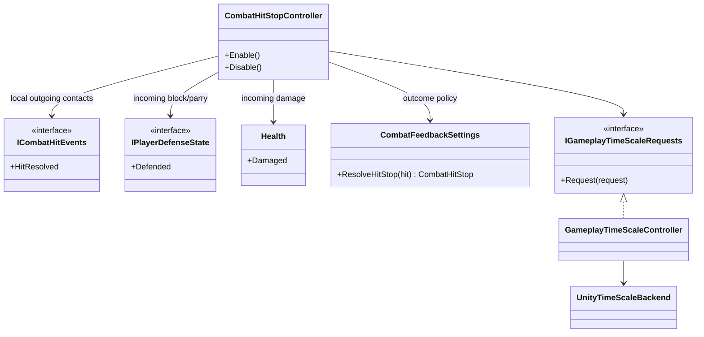

# Combat hit stop

This tree converts confirmed local combat contacts into bounded gameplay-time
requests. It does not decide whether a contact damages, blocks or parries, and
it never owns combat or animation state.

- Every request starts from a confirmed `CombatHitResult`; overlap and
  animation callbacks cannot freeze gameplay by themselves.
- Damaging hits retain the hit-stop authored by their attack unless their
  feedback definition explicitly overrides it. The current Player profile
  uses `0.045 s @ 0.18` for block and `0.09 s @ 0.02` for parry.
- Incoming defensive contacts arrive through `IPlayerDefenseState.Defended`
  because `Health.Damaged` correctly does not fire when damage is prevented.
- `GameplayTimeScaleController` is the only mutable owner of active requests.
  Overlapping requests use the lowest scale and longest remaining unscaled
  duration, then restore the captured baseline on disable or scope disposal.
- Guard/parry admission uses the unscaled combat clock. Hit stop therefore
  freezes presentation without extending the real-time parry opportunity.
