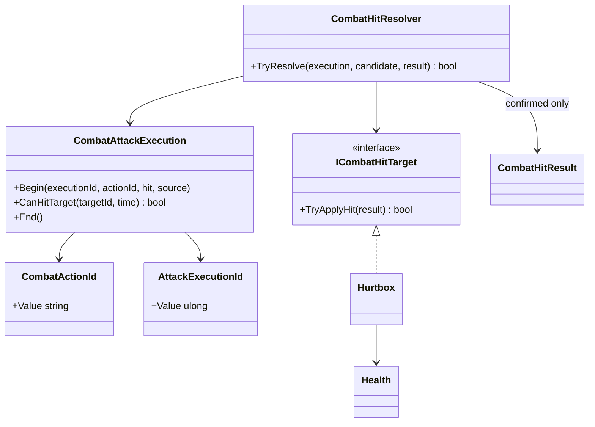

# Confirmed combat hits

This tree is the shared damage-delivery boundary for player, enemy and training
attacks. It does not own combo traversal, AI decisions or reaction state.

- `CombatActionId` identifies the semantic action that produced a hit without
  depending on the player combo graph. Player actions convert their local id at
  execution start; enemy actions can provide their own stable ids.
- `CombatAttackExecution` owns per-target repeat filtering for one activation.
- `CombatHitResolver` produces a result only after the target accepts damage.
  Rejected immunity, dead targets and duplicate overlaps publish no hit event.
- `Hurtbox` identifies the hit zone and delegates health ownership; it never
  calculates damage or chooses a reaction.
