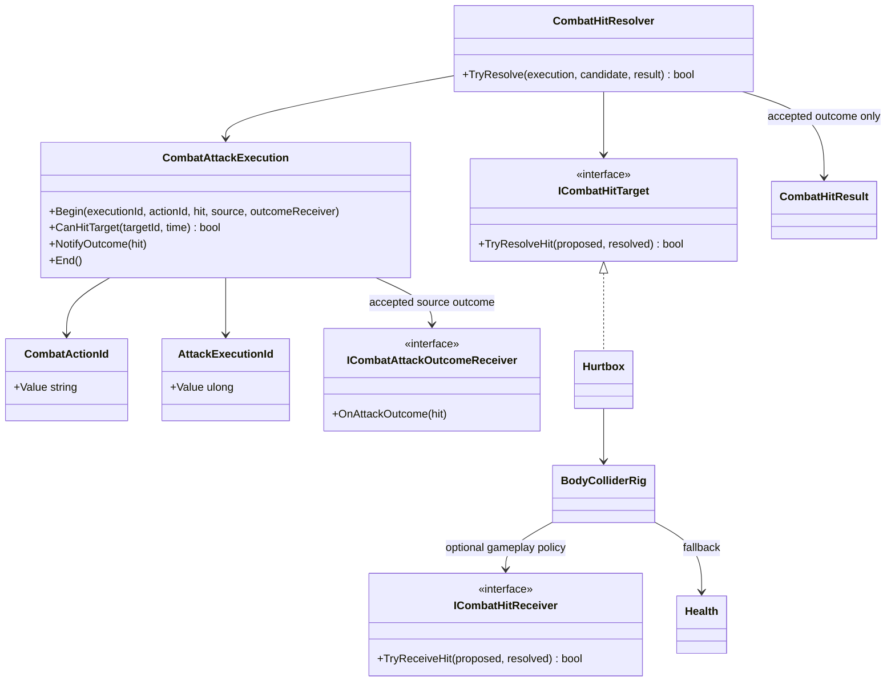

# Confirmed combat hits

This tree is the shared damage-delivery boundary for player, enemy and training
attacks. It does not own combo traversal, AI decisions or reaction state.

- `CombatActionId` identifies the semantic action that produced a hit without
  depending on the player combo graph. Player actions convert their local id at
  execution start; enemy actions can provide their own stable ids.
- `CombatAttackExecution` owns per-target repeat filtering for one activation.
- Every collider in a compound `BodyColliderRig` resolves to the same target
  identity. A single-hit execution therefore damages that actor once even when
  several generated hurtboxes overlap the weapon during the same sweep.
- Every execution has one explicit source-side outcome receiver. The resolver
  notifies it synchronously after the target accepts and repeat filtering is
  committed, so `Parried` can close the active hitbox before another physics
  contact is processed. This is a direct owner callback, not a global event or
  a scene lookup.
- `CombatHitResolver` produces a result only after the target accepts the
  contact. `CombatHitOutcome` distinguishes `Damaged`, `Blocked` and `Parried`;
  rejection (immunity, dead target or invalid contact) still produces no result.
- Only `Damaged` reaches `Health`, hit-confirm transitions and style scoring.
  Defensive outcomes remain confirmed contacts for repeat filtering and
  presentation without pretending that health damage occurred.
- `Hurtbox` identifies the hit zone and delegates target ownership; it never
  calculates damage or chooses a reaction. `BodyColliderRig` forwards to an
  attached gameplay receiver such as Player defense, then falls back to
  `Health` when no receiver owns the contact.
