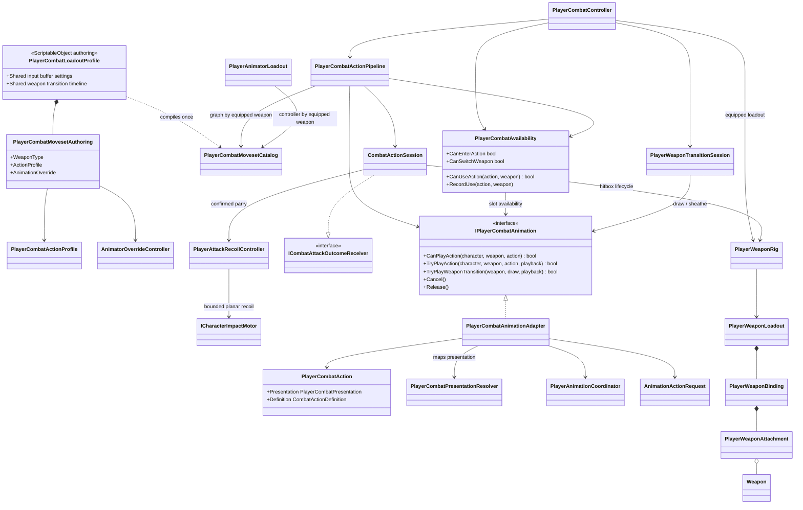

# Player combat coordination

This tree coordinates semantic commands, action chains, weapon transitions and
their presentation adapters. Damage resolution and character reactions remain
separate combat boundaries.

`PlayerCombatLoadoutProfile` is the single authoring map between an equipped
weapon, its immutable action graph and its animation override. The physical
`PlayerWeaponLoadout` remains scene-owned because it contains character-bone,
attachment and hitbox references. These are deliberately separate: changing
combat data never changes hierarchy ownership, while a physical weapon cannot
silently acquire an unrelated action graph.

- The loadout owns input-buffer policy and the weapon-transition timeline once;
  individual `PlayerCombatActionProfile` assets now contain only one moveset's
  actions, entries and transitions.
- The runtime catalog compiles every moveset during composition and rejects
  null profiles, duplicate weapon types, `None`, or a missing explicit
  `Unarmed` moveset before gameplay starts.
- `PlayerCombatActionPipeline` resolves the graph from the weapon committed at
  action start and keeps that graph fixed for the entire chain. Weapon
  switching remains available only from `Ready`, so a combo cannot cross into
  another weapon's graph.
- Weapon switching requires both a combat moveset and a complete physical
  weapon binding before transition playback starts; an incomplete future
  weapon cannot become the authoritative `CurrentWeapon`.
- `PlayerAnimatorLoadout` consumes the same catalog. `Unarmed` always uses the
  base XController; a weapon may provide an override which must share that base
  controller. Gameplay action ids and Animator state names remain stable.
- Cooldowns are keyed by `(weapon, action id)`. Two movesets may reuse semantic
  ids such as `combo.ground.0` without leaking cooldown state into each other.
- The initial loadout contains separate `UnarmedCombatActionProfile` and
  `DualSwordsCombatActionProfile` assets. Their graphs intentionally begin as
  copies, providing an explicit safe split for later weapon-specific tuning.

`PlayerCombatAvailability.RecordUse` is called immediately after the animation
driver accepts an action. Cooldown therefore belongs to the accepted gameplay
action and is not avoided when its session later ends through dodge, jump,
reaction, disable, or another interruption.

- The shared presentation resolver exposes three combo steps for every
  compatible animation loadout and maps them to semantic action `LightAttack`,
  variants `0...2`.
- Gameplay passes one `PlayerCombatAction` through the narrow animation port.
  `PlayerCombatPresentationResolver` alone interprets `ComboStep`,
  `AirComboStep` and `NamedAnimation`; both the adapter and editor contract
  validator consume it. `PlayerCombatController` does not know the available
  Animator slot counts or construct `AnimationActionRequest`.
- `PlayerCombatActionPipeline` owns graph traversal, contextual input buffering,
  combo index, action-to-action execution, confirmed-target carry and landing
  termination. `PlayerCombatController` owns input subscriptions, operation
  lifetime and persistent weapon state.
- `CombatActionSession` receives the accepted outcome of its own execution.
  `Parried` is an explicit end reason: the hit window closes and the running
  action is interrupted immediately. `Blocked` remains a confirmed contact but
  does not silently cancel the authored attack recovery.
- A confirmed parry also enters a separate source-side recoil state. It locks
  movement and new actions for the authored `0.55 s`, drives the shared
  reaction presentation, and submits one `2.75 m/s` planar impulse away from
  the defender through `ICharacterImpactMotor`. Collision, grounding and the
  resulting velocity remain owned by `CharacterMotor`; combat never writes the
  Transform directly.
- The command inbox captures the source action and its normalized time when the
  semantic input arrives. Timeline advancement cannot move a press into a
  different rapid/delayed branch during a slow frame; commands received together
  while Ready are still bound deterministically to the first action they start.
- A valid entry pressed while `Ready` is temporarily blocked by dodge or a
  reaction uses the same unscaled input-buffer rules as combo transitions. It
  is retried when the actor becomes available and expires normally instead of
  leaking into an unrelated action. `Dead` is not a temporary admission lock:
  entering it clears pending commands and input received while dead is rejected.
- Actor update has an explicit arbitration boundary: combat advances its
  current timeline first, locomotion evaluates that frame's cancel policy, and
  combat commands resolve afterwards. An accepted dodge clears commands already
  queued for that frame, so defensive movement wins a simultaneous `Ready`
  input without bypassing a closed action cancel window. A motor-confirmed jump
  still interrupts an active action through the same cleanup boundary. Accepted
  ground-jump startup reserves locomotion for the full anticipation window, so
  a new ground action cannot replace it before takeoff. A combat input pressed
  after that reservation is buffered and re-evaluated against airborne entry
  rules once the motor confirms the jump. Weapon switching is rejected during
  the same reservation instead of briefly starting a transition that takeoff
  would immediately cancel.
- Accepted dodge startup is also a locomotion reservation. It closes combat and
  weapon-switch admission until character simulation confirms dodge mode, so a
  fast render Update cannot insert a ground attack between input acceptance and
  the following physics step.
- Landing has the inverse handoff rule. An input already buffered against an
  active air action is re-evaluated once against the grounded entry graph before
  the air session releases animation ownership. A valid command therefore
  crossfades directly into its ground action; an invalid or expired command is
  discarded and locomotion resumes normally.
- `PlayerCombatAvailability` owns live actor/reaction admission checks and the
  scaled-time cooldown dictionary. It asks the animation port only whether the
  semantic presentation exists; it does not run the graph or mutate combat
  phase.
- The Animator Controller maps those variants to `BaseAttack1...3`; gameplay
  code has no clip reference.
- The adapter exposes a separate three-step air track and maps it to semantic
  action `AirAttack`, variants `0...2`, then to `AirAttack1...3`.
- The first two air steps follow the confirmed target while clamping descent to
  their authored `MinimumVelocity`. The third step is a slam: target-height
  tracking is disabled so its exact `-9 m/s` actor descent and `-12 m/s` target
  impact cannot be replaced by a height-correction velocity. Its action supports
  both environments so the landing frame does not terminate the authored impact
  phase; graph topology still permits entry only from the airborne combo.
- The named `skill.special` presentation maps to semantic action
  `SpecialAttack`, variant `0`, then to the existing `Attack/Skill` state. Its
  legality, hit window, cancel window and cooldown remain graph-owned.
- The named `attack.heavy` presentation maps to semantic action `HeavyAttack`,
  variant `0`, then to `Attack/BaseAttack4`. Its confirmed hit requests
  `hit.heavy` and crosses the reaction profile's knockdown threshold.
- Gameplay passes the expected duration as presentation metadata, but the
  current XController adapter keeps the authored clip speed. Gameplay timing
  and Animator normalized time are intentionally independent.
- A command that is still alive in the input buffer at action completion is
  resolved again through the graph's entry rules. This lets a late recovery
  input start the next valid ground/air action instead of being cleared merely
  because it missed the previous action's chain or cancel window.
- An airborne-only action is interrupted as soon as the actor lands. The
  session closes its hitbox and releases combat motion; the controller
  crossfades the Animator back to locomotion instead of letting an aerial clip
  finish on the ground. Actions valid in both environments are not affected.
- A confirmed launcher target is carried through the non-damaging air chase
  into the air combo. When one swing confirms several targets, the target
  selected by combat motion/lock-on wins if it was hit; otherwise the nearest
  confirmed target is selected deterministically instead of depending on
  Physics overlap order. Direct airborne entries fall back to the current
  lock-on; independent buffered entries clear the carried target.
- `PlayerWeaponRig` selects one authored weapon binding and enables every
  attachment hitbox only during the confirmed hit window. Unarmed combat keeps
  its separate hand hitboxes. `PlayerWeaponLoadout` samples active shapes once
  in `LateUpdate`; `Weapon` combines the bounded sweep with trigger callbacks
  and reports candidates to `CombatHitResolver`.
- Swept overlap storage starts at 32 colliders and grows only after an actual
  saturation, up to a hard limit of 256. Compound hurtbox crowds therefore do
  not silently lose contacts at the two-character boundary, while the hot path
  remains allocation-free after its observed density has been accommodated.
- Weapon colliders are gameplay volumes rather than exact mesh shells. The
  current Dual Swords capsules use a `0.14` local radius (`0.07 m` at the
  character's `0.5` visual scale), enough to cover the measured transverse
  swing gap without replacing action-specific reach or target filtering.
- `Cancel()` asks the XController adapter to crossfade to locomotion when
  gameplay interrupts an action. Normal completion lets the controller use its
  authored exit transition.
- `PlayerWeaponTransitionSession` owns the transient sheathe/draw sequence and
  commits the weapon rig only at the authored timeline point. Cancellation
  restores the Animator loadout of the last committed weapon; the controller
  remains the sole owner of persistent `CurrentWeapon`.
- Weapon transitions, three-step ground/air light combos, a grounded heavy,
  a timing-sampled `Light -> pause -> Light` finisher, the first grounded named
  special and the launcher-to-air-chase route are implemented. Dual Swords can
  start a launcher directly from `Ready`; every completed ground-light step can
  also cancel into heavy, while a confirmed hit can cancel into the launcher.
  The pause finisher currently reuses the heavy presentation slot; additional
  named skills remain deferred.
