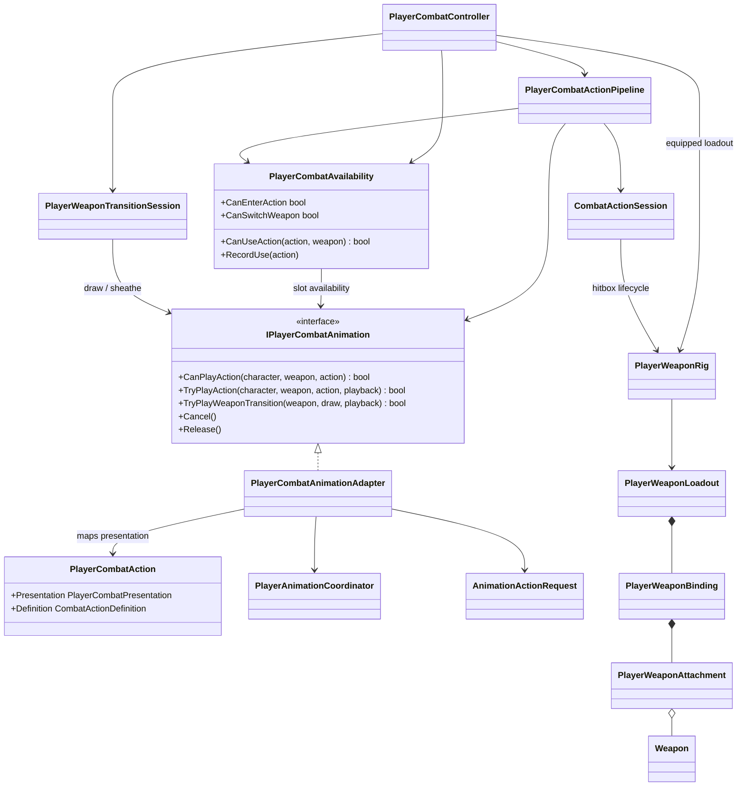

# Player combat coordination

This tree coordinates semantic commands, action chains, weapon transitions and
their presentation adapters. Damage resolution and character reactions remain
separate combat boundaries.

- The adapter exposes three combo steps for every compatible animation loadout
  and maps them to semantic action `LightAttack`, variants `0...2`.
- Gameplay passes one `PlayerCombatAction` through the narrow animation port.
  The adapter alone interprets `ComboStep`, `AirComboStep` and `NamedAnimation`;
  `PlayerCombatController` does not know the available Animator slot counts or
  construct `AnimationActionRequest`.
- `PlayerCombatActionPipeline` owns graph traversal, contextual input buffering,
  combo index, action-to-action execution, confirmed-target carry and landing
  termination. `PlayerCombatController` owns input subscriptions, operation
  lifetime and persistent weapon state.
- `PlayerCombatAvailability` owns live actor/reaction admission checks and the
  scaled-time cooldown dictionary. It asks the animation port only whether the
  semantic presentation exists; it does not run the graph or mutate combat
  phase.
- The Animator Controller maps those variants to `BaseAttack1...3`; gameplay
  code has no clip reference.
- The adapter exposes a separate three-step air track and maps it to semantic
  action `AirAttack`, variants `0...2`, then to `AirAttack1...3`.
- The named `skill.special` presentation maps to semantic action
  `SpecialAttack`, variant `0`, then to the existing `Attack/Skill` state. Its
  legality, hit window, cancel window and cooldown remain graph-owned.
- The named `attack.heavy` presentation maps to semantic action `HeavyAttack`,
  variant `0`, then to `Attack/BaseAttack4`. Its confirmed hit requests
  `hit.heavy` and crosses the reaction profile's knockdown threshold.
- Gameplay passes the expected duration as presentation metadata, but the
  current XController adapter keeps the authored clip speed. Gameplay timing
  and Animator normalized time are intentionally independent.
- A command that is still alive in the input buffer at action completion is
  resolved again through the graph's entry rules. This lets a late recovery
  input start the next valid ground/air action instead of being cleared merely
  because it missed the previous action's chain or cancel window.
- An airborne-only action is interrupted as soon as the actor lands. The
  session closes its hitbox and releases combat motion; the controller
  crossfades the Animator back to locomotion instead of letting an aerial clip
  finish on the ground. Actions valid in both environments are not affected.
- A confirmed launcher target is carried through the non-damaging air chase
  into the air combo. Direct airborne entries fall back to the current lock-on;
  independent buffered entries clear the carried target.
- `PlayerWeaponRig` selects one authored weapon binding and enables every
  attachment hitbox only during the confirmed hit window. Unarmed combat keeps
  its separate hand hitboxes. `PlayerWeaponLoadout` samples active shapes once
  in `LateUpdate`; `Weapon` combines the bounded sweep with trigger callbacks
  and reports candidates to `CombatHitResolver`.
- `Cancel()` asks the XController adapter to crossfade to locomotion when
  gameplay interrupts an action. Normal completion lets the controller use its
  authored exit transition.
- `PlayerWeaponTransitionSession` owns the transient sheathe/draw sequence and
  commits the weapon rig only at the authored timeline point. Cancellation
  restores the Animator loadout of the last committed weapon; the controller
  remains the sole owner of persistent `CurrentWeapon`.
- Weapon transitions, three-step ground/air light combos, a grounded heavy,
  a timing-sampled `Light -> pause -> Light` finisher, the first grounded named
  special and the launcher-to-air-chase route are implemented. The pause
  finisher currently reuses the heavy presentation slot; additional named
  skills remain deferred.
