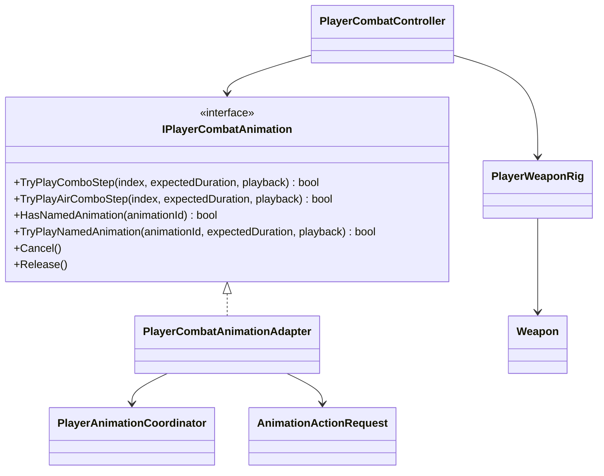

# Player combat presentation

This tree translates an accepted combat action into a semantic Animator action.
It does not decide action legality, damage or cancel timing.

- The adapter exposes three combo steps for every compatible animation loadout
  and maps them to semantic action `LightAttack`, variants `0...2`.
- The Animator Controller maps those variants to `BaseAttack1...3`; gameplay
  code has no clip reference.
- The adapter exposes a separate three-step air track and maps it to semantic
  action `AirAttack`, variants `0...2`, then to `AirAttack1...3`.
- The named `skill.special` presentation maps to semantic action
  `SpecialAttack`, variant `0`, then to the existing `Attack/Skill` state. Its
  legality, hit window, cancel window and cooldown remain graph-owned.
- The named `attack.heavy` presentation maps to semantic action `HeavyAttack`,
  variant `0`, then to `Attack/BaseAttack4`. Its confirmed hit requests
  `hit.heavy` and crosses the reaction profile's knockdown threshold.
- Gameplay passes the expected duration as presentation metadata, but the
  current XController adapter keeps the authored clip speed. Gameplay timing
  and Animator normalized time are intentionally independent.
- `PlayerWeaponRig` enables two hand hitboxes only during the confirmed hit
  window. `Weapon` reports collision candidates to `CombatHitResolver`.
- `Cancel()` asks the XController adapter to crossfade to locomotion when
  gameplay interrupts an action. Normal completion lets the controller use its
  authored exit transition.
- Weapon transitions, three-step ground/air light combos, a grounded heavy and
  the first grounded named special are implemented. Launcher and additional
  named skills remain deferred.
