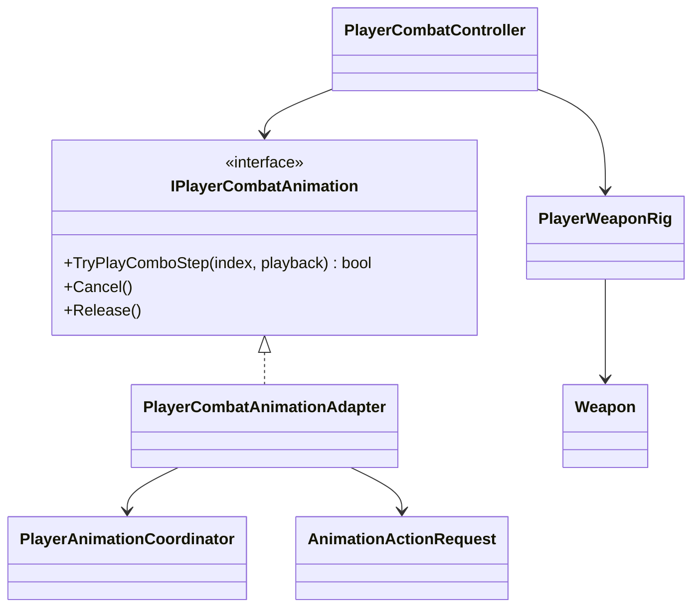

# Player combat presentation

This tree translates an accepted combat action into a semantic Animator action.
It does not decide action legality, damage or cancel timing.

- The current adapter exposes one unarmed combo step and maps it to semantic
  action `LightAttack`.
- The Animator Controller maps that semantic action to
  `HMGT_BasicCombo_01`; gameplay code has no clip reference.
- `PlayerWeaponRig` enables two hand hitboxes only during the confirmed hit
  window. `Weapon` reports collision candidates to `CombatHitResolver`.
- `Cancel()` sends an explicit Animator cancel trigger when gameplay interrupts
  an action. Normal completion lets the controller use its authored exit
  transition.
- Weapon transitions, named skills, air attacks and combo chains are deferred.
