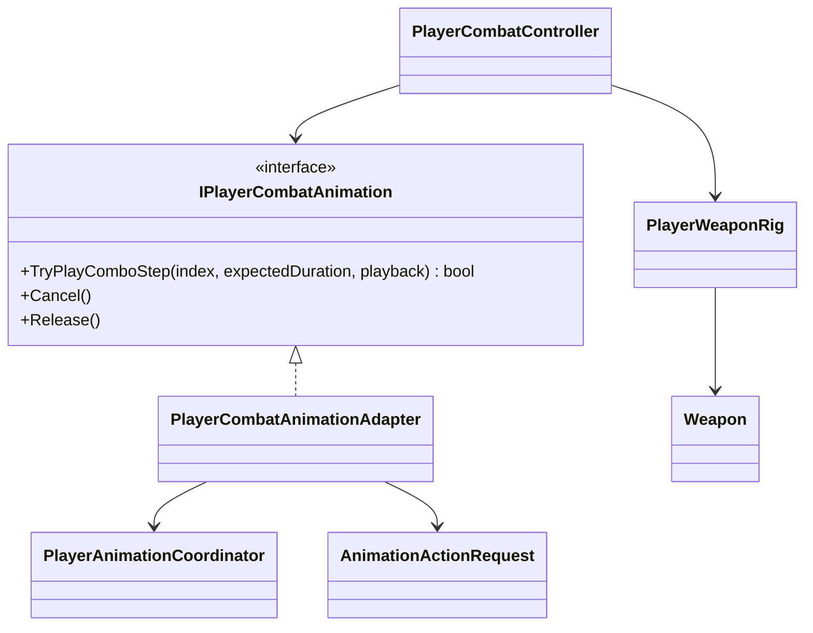

# Player combat presentation

This tree translates an accepted combat action into a semantic Animator action.
It does not decide action legality, damage or cancel timing.

- The adapter exposes four combo steps for every compatible animation loadout
  and maps them to semantic action `LightAttack`, variants `0...3`.
- The Animator Controller maps those variants to `BaseAttack1...4`; gameplay
  code has no clip reference.
- The fourth prototype step is the current heavy finisher: its confirmed hit
  requests `hit.heavy` and crosses the reaction profile's knockdown threshold.
- Gameplay passes the expected duration as presentation metadata, but the
  current XController adapter keeps the authored clip speed. Gameplay timing
  and Animator normalized time are intentionally independent.
- `PlayerWeaponRig` enables two hand hitboxes only during the confirmed hit
  window. `Weapon` reports collision candidates to `CombatHitResolver`.
- `Cancel()` asks the XController adapter to crossfade to locomotion when
  gameplay interrupts an action. Normal completion lets the controller use its
  authored exit transition.
- Weapon transitions and the ground light combo are implemented. Named skills,
  heavy branches and air attacks remain deferred.
