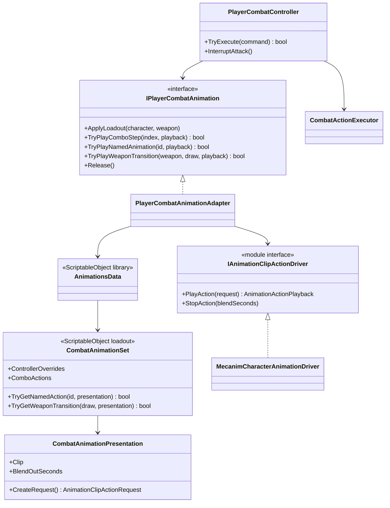

# Player combat presentation

This tree adapts confirmed Project S combat actions to animation presentation.
It does not decide whether an attack is legal, when damage is applied or when a
cancel window opens.

## Class diagram

## Dependencies and ownership

- `PlayerCombatController` and `CombatActionExecutor` own action authority,
  normalized gameplay windows, interruption and root-motion policy.
- `CombatAnimationSet` is immutable authoring data for one weapon loadout. Clip
  replacement and blend tuning do not change the combat action graph.
- `PlayerCombatAnimationAdapter` resolves a presentation and returns only its
  effective duration. It never reads Animator state or clip progress.
- `MecanimCharacterAnimationDriver` owns the PlayableGraph. Consecutive actions
  crossfade between two clip inputs; release blends the action lane back to the
  controller pose.
- Controller overrides are restricted to continuous loadout locomotion. Finite
  combo, skill and draw/sheathe clips are played directly and have no Animator
  placeholder states.
- AvatarMask is a presentation choice. Root motion remains an explicit gameplay
  policy applied by `CombatActionExecutor` through `IRootMotionPolicyTarget`.

## Current authoring

The player animation library references `Unarmed_CombatAnimationSet` and
`TwoHanded_CombatAnimationSet`. Both contain four combo actions and one named
`skill.special` action. The two-handed set additionally contains explicit draw
and sheathe actions plus nine continuous locomotion overrides.
