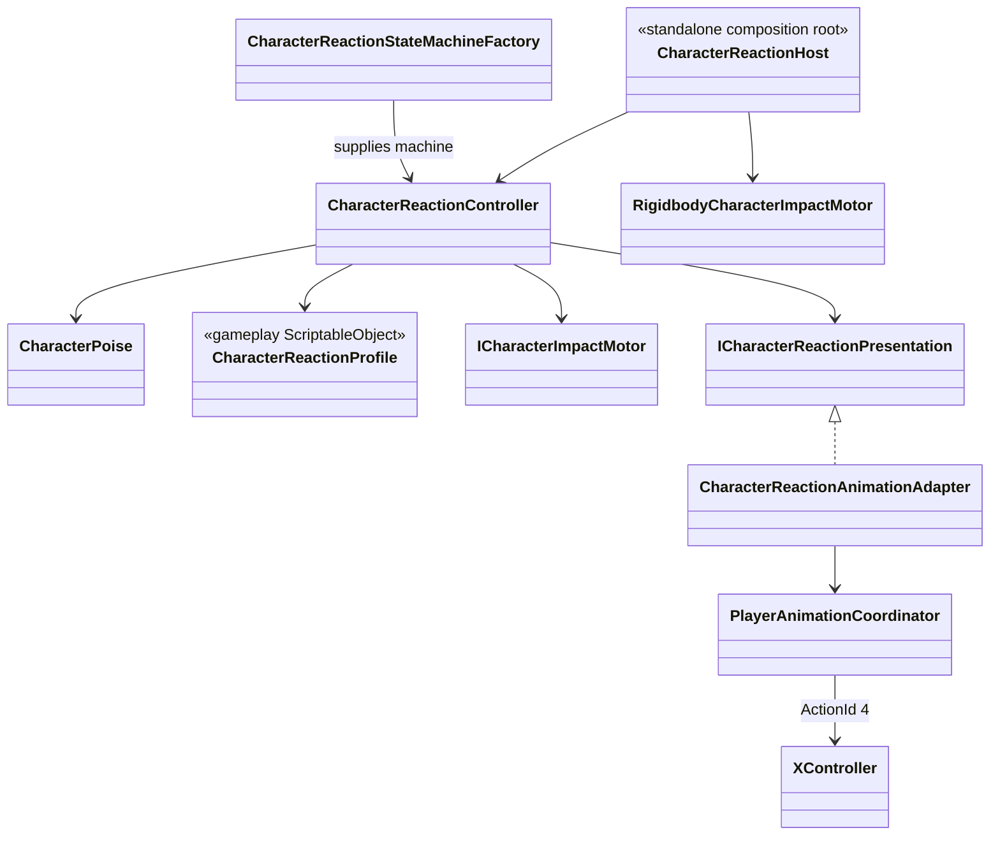

# Character reaction presentation

Reaction gameplay and animation presentation have separate owners.

- `CharacterReactionController` owns stable, hit-stun, knockdown, get-up,
  airborne and dead gameplay states, their timers, poise and the source-side
  direction captured when a hit is confirmed.
- `CharacterReactionAnimationAdapter` may request a semantic reaction slot but
  never changes reaction gameplay state.
- Reaction and death outrank combat and locomotion in
  `PlayerAnimationCoordinator`.
- Repeated hit, reset, revive, disable and scope teardown release presentation
  idempotently.
- `CharacterReactionStateMachineFactory` creates the same state topology for the
  VContainer-owned Player controller and standalone character hosts.
- `CharacterReactionHost` is a local composition root for scene/prefab actors
  that do not yet have their own VContainer scope. It does not duplicate poise,
  timers or transition rules.
- `XController` maps semantic action id `4` to nine required slots:
  `Reaction/HitStun`, `Reaction/HitStun_Back`, `Reaction/HitStun_Left`,
  `Reaction/HitStun_Right`, `Reaction/Knockdown`, `Reaction/Airborne`,
  `Reaction/Dead_1`, `Reaction/Dead_2` and `Reaction/GetUp`. Weapon override
  controllers inherit the slots.
- Direction names describe the source side relative to the target. Gameplay
  computes that value once from the confirmed impulse and target orientation;
  rotation during the reaction does not select a different clip. Only hit-stun
  is directional today; other reaction states retain their common fallback.
- Death selection uses the existing semantic `ReactionId`: `hit.heavy` selects
  `Dead_2`; missing, light and unknown ids fall back to `Dead_1`.
- Reaction and death slots keep their authored playback speed. Gameplay still
  owns the reaction duration and cancels presentation on return to `Stable`;
  short hit-stun windows never accelerate the source clip.
- The current reaction states reference Humanoid proxy motions from the Knight
  and CLazy sets. Left/right use the same `LightHit` clip with Animator mirroring,
  while front/back use normal/alternate `LightHit` slots. The
  imported FBX clips are not modified and contain no gameplay Animation Events.
  They remain replaceable content slots; damage, death and collision ownership
  stay in gameplay code.
- Timed reaction states have no Animator-owned gameplay transitions. Knockdown
  completion explicitly enters `GetUp`; get-up completion cancels presentation
  back to locomotion. Both death states hold their final frame until revive.
- Vertical impact is signed: positive speed launches along actor up, while
  negative speed drives an airborne actor down. A downward impact becomes
  `Knockdown` only when the motor confirms landing and is not applied twice.
- `CombatTrainingTarget.prefab` duplicates the Player visual and generated body
  hurtboxes, but removes player input, locomotion, combat and weapon ownership.
  It adds `CombatTarget`, `CharacterReactionHost` and
  `RigidbodyCharacterImpactMotor` for end-to-end hit validation.
- The standalone grounded `attack.heavy` action is authored as `hit.heavy` with
  enough knockback to enter `Knockdown`; all three light-combo steps remain light.
