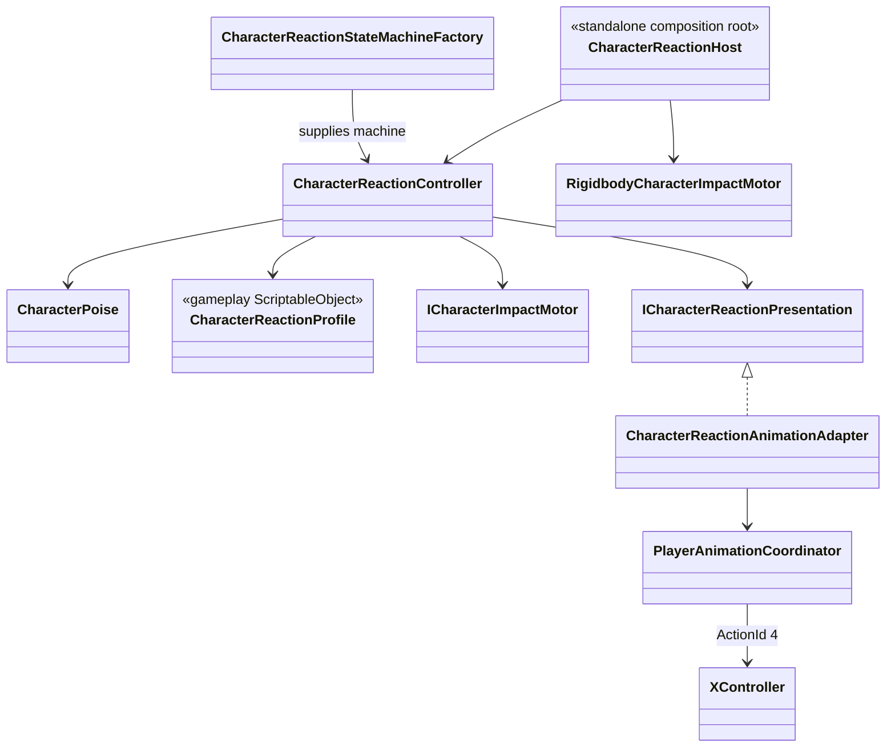

# Character reaction presentation

Reaction gameplay and animation presentation have separate owners.

- `CharacterReactionController` owns stable, hit-stun, knockdown, airborne and
  dead gameplay states, their timers and poise.
- `CharacterReactionAnimationAdapter` may request a semantic reaction slot but
  never changes reaction gameplay state.
- Reaction and death outrank combat and locomotion in
  `PlayerAnimationCoordinator`.
- Repeated hit, reset, revive, disable and scope teardown release presentation
  idempotently.
- `CharacterReactionStateMachineFactory` creates the same state topology for the
  VContainer-owned Player controller and standalone character hosts.
- `CharacterReactionHost` is a local composition root for scene/prefab actors
  that do not yet have their own VContainer scope. It does not duplicate poise,
  timers or transition rules.
- `XController` maps semantic action id `4` to four stable slots:
  `Reaction/HitStun`, `Reaction/Knockdown`, `Reaction/Airborne` and
  `Reaction/Dead`. Weapon override controllers inherit the slots.
- Reaction and death slots keep their authored playback speed. Gameplay still
  owns the reaction duration and cancels presentation on return to `Stable`;
  short hit-stun windows never accelerate the source clip.
- The current reaction states reference Humanoid proxy motions from one Knight
  set: normal and alternate `LightHit`, `Fall`, and `Death`. The imported FBX
  clips are not modified and contain no gameplay Animation Events. They remain
  replaceable content slots; damage, death and collision ownership stay in
  gameplay code.
- Timed reaction states have no Animator-owned gameplay transitions. Their
  authoritative state completion cancels presentation back to locomotion;
  `Dead` holds its final frame until revive.
- `CombatTrainingTarget.prefab` duplicates the Player visual and generated body
  hurtboxes, but removes player input, locomotion, combat and weapon ownership.
  It adds `CombatTarget`, `CharacterReactionHost` and
  `RigidbodyCharacterImpactMotor` for end-to-end hit validation.
- The fourth prototype ground-combo action is authored as `hit.heavy` with
  enough knockback to enter `Knockdown`; earlier combo steps remain light.
