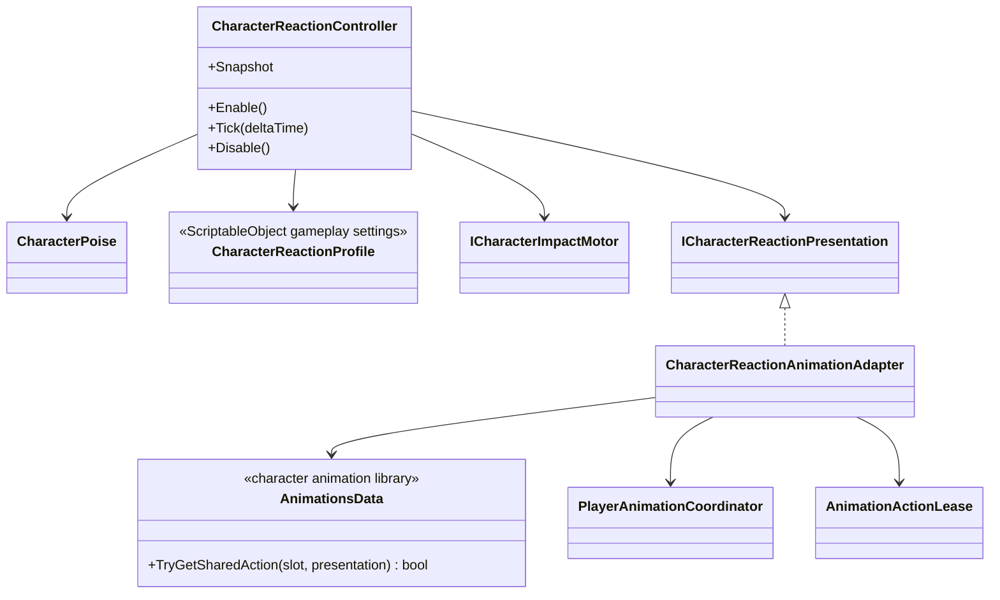

# Character reactions

This tree owns reaction gameplay state and adapts its confirmed snapshots to
movement impact and animation presentation. Animation failure never cancels
damage, poise changes or death.

## Class diagram

## Dependencies and ownership

- `CharacterReactionController` is the sole owner of stable, hit-stun,
  knockdown, airborne and dead gameplay states. Timers and poise remain outside
  Animator and Playables.
- `CharacterReactionProfile` contains gameplay tuning only. Presentation clips
  belong to the character-wide `AnimationsData` library.
- The adapter resolves `Reaction.<State>.<ReactionId>` first and
  `Reaction.<State>` second. If no finite clip is authored, it requests the
  corresponding optional controller-backed semantic state.
- Hit-stun, knockdown and airborne actions claim the `Reaction` channel. Death
  claims the non-interruptible `Death` channel. Both outrank traversal and
  combat.
- A repeated hit replaces the previous reaction lease safely. Reset, revive,
  disable and scene teardown release both reaction channels idempotently.

## Current authoring

`Player_AnimationsData.asset` currently has no shared reaction clips. The
adapter therefore uses optional semantic-state fallback and does not borrow the
boss or goblin hit clips for the player. Temporary or final player clips can be
added later with ids such as `Reaction.HitStun`, `Reaction.Knockdown` and
`Reaction.Dead` without changing reaction gameplay code.
