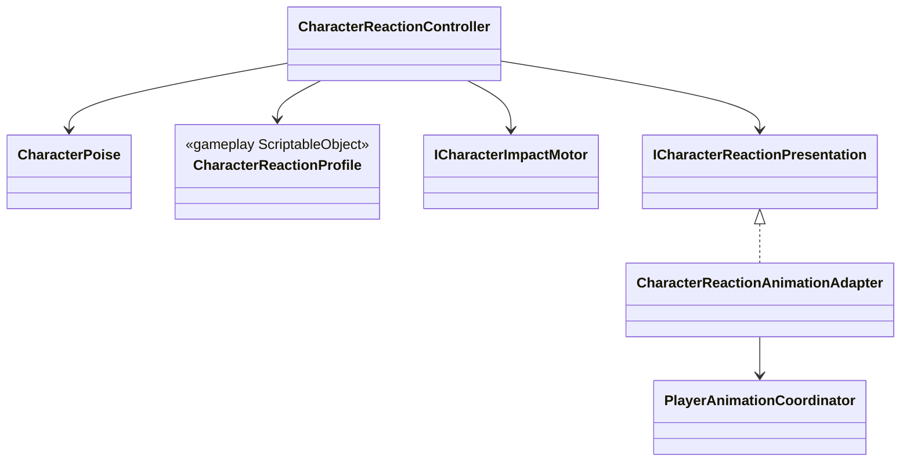

# Character reaction presentation

Reaction gameplay and animation presentation have separate owners.

- `CharacterReactionController` owns stable, hit-stun, knockdown, airborne and
  dead gameplay states, their timers and poise.
- `CharacterReactionAnimationAdapter` may request a semantic reaction slot but
  never changes reaction gameplay state.
- Reaction and death outrank combat and locomotion in
  `PlayerAnimationCoordinator`.
- Repeated hit, reset, revive, disable and scope teardown release presentation
  idempotently.
- No KurtzPel reaction clip is mapped yet. Missing presentation does not block
  damage, knockback or death; reaction states will be added to the conventional
  Animator Controller later.
