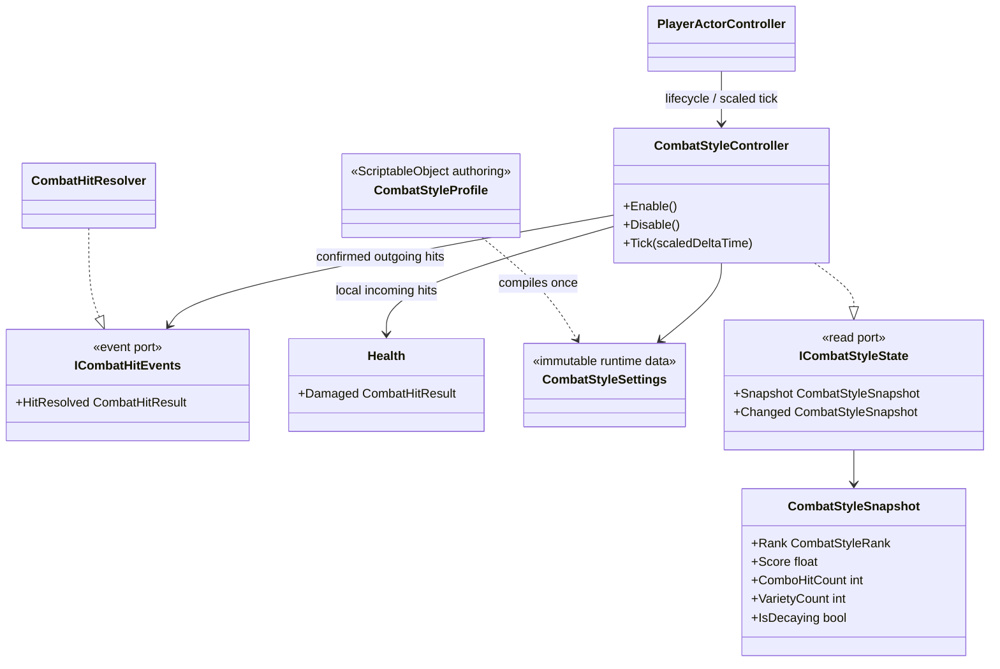

# Combat style state

The style state observes accepted combat results. It never decides whether an
attack hits, changes damage, opens a cancel window or drives an Animator.

- A score award is produced only from `CombatHitResult` after the target accepts
  damage. Trigger overlaps and animation callbacks cannot increase style.
- Reusing an action found in the bounded recent-action ring applies a
  multiplicative penalty. Different action ids restore variety naturally; no
  allocations or string construction occur per hit.
- Heavy, launcher and slam reactions may add authoring bonuses. They do not
  change reaction gameplay or damage.
- Incoming local damage clears the hit chain and recent variety, retains only
  the configured score fraction and starts decay immediately.
- Delay and decay use scaled gameplay time. Hit stop therefore freezes style
  decay together with the action timeline instead of consuming the grace
  period in real time.
- The hit chain and recent-action variety expire when the decay delay is
  crossed, while the accumulated style score continues to decay independently.
  A later encounter therefore starts a new combo and does not inherit the old
  repetition penalty. The first decay frame consumes only the portion of its
  delta that lies beyond the delay boundary.
- `ICombatStyleState` is the future UI boundary. A Passive View presenter may
  subscribe to `Changed`, but UI must not mutate score or combat state.
- Enable, disable and scope disposal own all subscriptions. Disable returns the
  published state to `None` without touching combat, health or animation.
