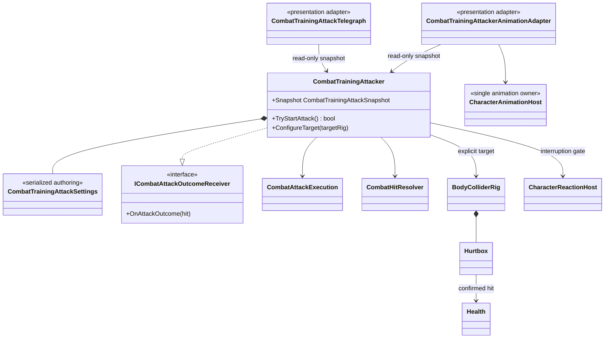

# Combat training attacker

This tree closes the incoming-hit side of the current combat vertical slice. It
is a deterministic test actor, not the foundation of the future enemy AI.

- The actor owns a fixed `Waiting -> Windup -> Active -> Recovery` loop plus a
  source-side `Active -> ParryStagger -> Waiting` branch. The configured
  one-second stagger is the deterministic punish window after a successful
  player parry.
  Target choice, navigation and tactical decisions intentionally remain outside
  this test boundary.
- A target `BodyColliderRig` is assigned explicitly by the scene. There is no
  tag lookup, global registry or `Find*` fallback.
- The active window uses the same `CombatAttackExecution`, repeat filtering,
  `CombatHitResolver`, `Hurtbox` and `Health` path as player weapons. Damage
  immunity can reject a frame without consuming the execution, allowing the
  window to validate dodge timing correctly.
- Being hit, knocked down or killed interrupts the attack and closes its active
  execution. Revive restarts the initial delay.
- A confirmed `Parried` result closes the active execution synchronously before
  another target contact can resolve. `Blocked` continues into normal recovery.
- The telegraph reads a snapshot and renders a runtime range ring: orange/red
  describes windup/active and pulsing cyan describes the parry punish window.
  It never applies damage or changes attack timing.
- The animation adapter observes the same phase and requests the existing
  Humanoid `Reaction/HitStun` slot once on entry to `ParryStagger`. It does not
  add Animator states or transitions. Damage/death reactions can replace it at
  the shared coordinator's reaction priority, and normal phase exit releases
  ownership without forcing a transition.
- `CombatActionId` belongs to the shared hit boundary. Player graph identifiers
  are converted only when a player action begins, so enemy/test attacks do not
  depend on player combo types.
