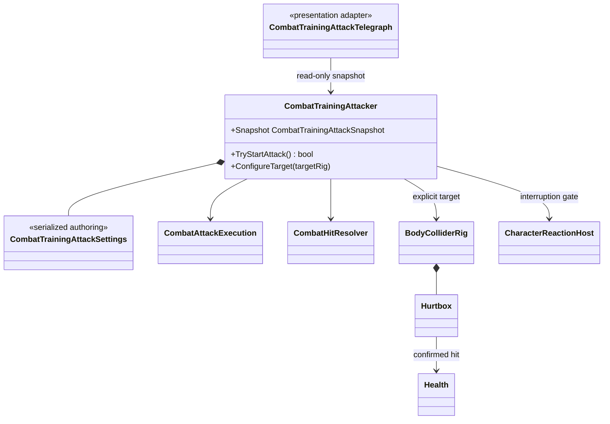

# Combat training attacker

This tree closes the incoming-hit side of the current combat vertical slice. It
is a deterministic test actor, not the foundation of the future enemy AI.

- The actor owns only a fixed `Waiting -> Windup -> Active -> Recovery` loop.
  Target choice, navigation and tactical decisions intentionally remain outside
  this test boundary.
- A target `BodyColliderRig` is assigned explicitly by the scene. There is no
  tag lookup, global registry or `Find*` fallback.
- The active window uses the same `CombatAttackExecution`, repeat filtering,
  `CombatHitResolver`, `Hurtbox` and `Health` path as player weapons. Damage
  immunity can reject a frame without consuming the execution, allowing the
  window to validate dodge timing correctly.
- Being hit, knocked down or killed interrupts the attack and closes its active
  execution. Revive restarts the initial delay.
- The telegraph reads a snapshot and renders a runtime range ring. It never
  applies damage or changes attack timing.
- `CombatActionId` belongs to the shared hit boundary. Player graph identifiers
  are converted only when a player action begins, so enemy/test attacks do not
  depend on player combo types.
