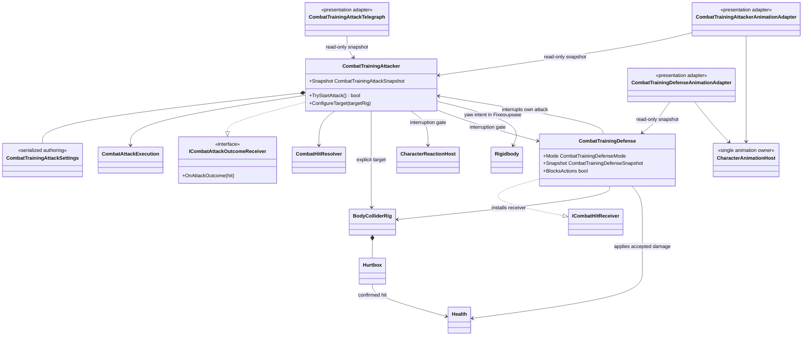

# Combat training actor

This tree closes the incoming-hit side of the current combat vertical slice. It
is a deterministic test actor, not the foundation of the future enemy AI.

- The actor owns a fixed `Waiting -> Windup -> Active -> Recovery` loop plus a
  source-side `Active -> ParryStagger -> Waiting` branch. The configured
  two-second stagger is the deterministic punish window after a successful
  player parry. The player's full `1.50 s` parry recovery leaves a bounded
  `0.50 s` counterattack window without cutting the Humanoid parry clip.
  Target choice, navigation and tactical decisions intentionally remain outside
  this test boundary.
- A target `BodyColliderRig` is assigned explicitly by the scene. There is no
  tag lookup, global registry or `Find*` fallback.
- Waiting and windup rotate the Rigidbody toward that target at the authored
  `540 deg/s`; active, recovery and parry-stagger lock the committed attack
  direction. The upright body remains physics-owned and no transform rotation
  is written from `Update`.
- A contact must be both within `2.4 m` and inside the authored `100 degree`
  forward cone. A rear or side target does not consume the execution and takes
  no damage, so the visible swing, hit query and Player guard arc agree.
- The active window uses the same `CombatAttackExecution`, repeat filtering,
  `CombatHitResolver`, `Hurtbox` and `Health` path as player weapons. Damage
  immunity can reject a frame without consuming the execution, allowing the
  window to validate dodge timing correctly.
- Being hit, knocked down or killed interrupts the attack and closes its active
  execution. Revive restarts the initial delay.
- A confirmed `Parried` result closes the active execution synchronously before
  another target contact can resolve. `Blocked` continues into normal recovery.
- The telegraph reads a snapshot and renders the same forward attack sector:
  orange/red describes windup/active, while a pulsing cyan circle describes the
  parry punish window.
  It never applies damage or changes attack timing.
- The animation adapter enters the existing Humanoid `Attack/BaseAttack1` once
  at `Windup`. Its `0.45 / 0.32 / 0.90 s` gameplay phases place the active hit
  at normalized `0.27...0.46`, matching the current semantic clip window while
  keeping a deliberately readable windup. The driver stretches the complete
  clip over the same `1.67 s` action without moving gameplay authority into the
  Animator.
- On entry to `ParryStagger`, that adapter requests the existing
  `Reaction/HitStun` slot at higher priority. It adds no Animator states or
  transitions. Damage/death reactions may replace it through the same shared
  coordinator. Because the current `HitStun` state has no autonomous exit, a
  normal training-stagger completion explicitly cancels the reaction source
  back to `Move`; an active damage reaction keeps ownership.
- `CombatTrainingDefense` is a deterministic receiver used to exercise the
  complete outgoing-hit path without introducing enemy AI. Its default
  `Cycle` policy repeats `Damaged -> Blocked -> Parried` for confirmed hits.
  `Vulnerable`, `Block` and `Parry` modes remain available for focused manual
  checks.
- Block and parry only apply inside the authored `180 degree` frontal guard
  arc. A rear hit remains damage, so facing is part of the same contract used
  by player defense.
- A defended hit returns the resolved `Blocked` or `Parried` outcome through
  `CombatHitResolver`. This lets source-side systems react normally: in
  particular, a player attack parried by the target closes its active session
  and enters `PlayerAttackRecoilController` rather than relying on an Animator
  callback.
- The bounded `0.50 s` block and `0.75 s` parry states interrupt and gate the
  target's own training attack. Their animation adapter uses the shared
  `CharacterAnimationHost` Defense source and returns to locomotion when the
  state ends; it never creates or owns another Animator.
- Disabling the defense releases its `BodyColliderRig` receiver and resets the
  cycle. Re-enabling installs the same explicit receiver again, preventing a
  stale callback from surviving scene or prefab lifecycle changes.
- `CombatActionId` belongs to the shared hit boundary. Player graph identifiers
  are converted only when a player action begins, so enemy/test attacks do not
  depend on player combo types.
