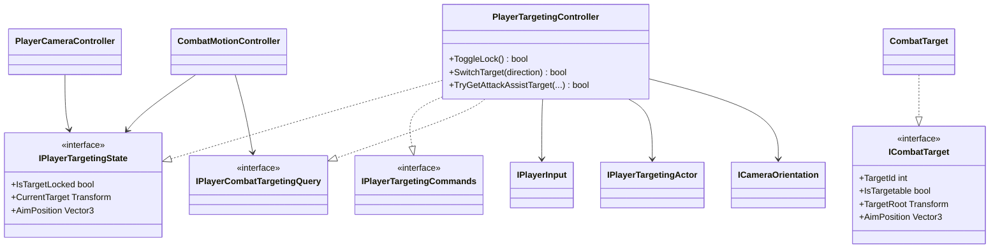

# Player targeting

Targeting owns target selection. Camera, combat motion and animation consume its
confirmed state through narrow read-only contracts.

- Hard lock is explicit player state. It owns the selected target and the
  temporary actor rotation mode, restoring the previous mode when lock is lost.
- Acquisition and target switching score visible `ICombatTarget` instances in
  camera space. Multiple colliders belonging to one target are deduplicated by
  `TargetId`.
- Attack assist is a separate one-shot query inside an authored distance and
  cone. It never mutates hard lock, camera state or the actor rotation policy.
- `CombatTarget` owns scene references for the root, aim point and optional
  health gate. A dead or disabled target is not targetable.
- Physics queries use the `Enemy` layer, bounded reusable buffers and explicit
  line-of-sight checks. Gameplay code never searches folders or scene names.
- All command and query entry points are inert outside the controller lifecycle.
  `ClearTarget()` remains available during teardown so rotation ownership is
  always released.
