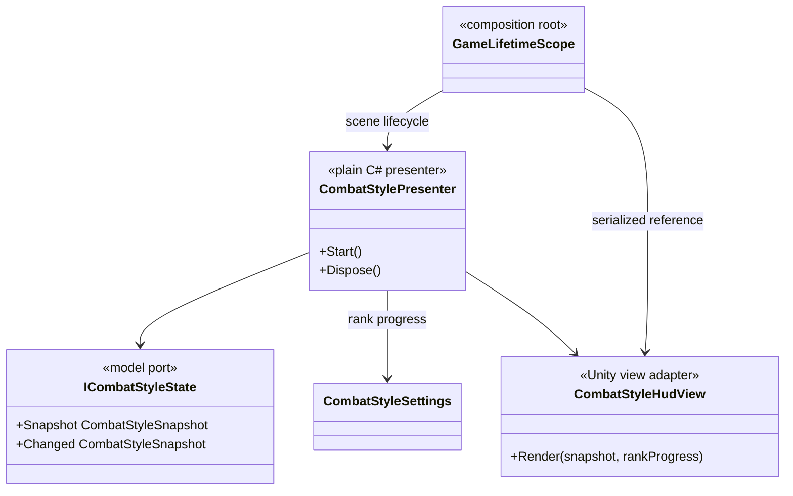

# Combat style HUD

The HUD follows MVP Passive View and is optional for gameplay composition.

- The presenter subscribes to the read-only style model and converts score to
  rank progress. It does not call combat commands or inspect scene actors.
- The view owns only TextMesh Pro, Image and CanvasGroup references. It formats
  numeric values with TMP overloads and never reads gameplay state directly.
- Absence of a HUD reference skips presenter composition; combat style remains
  operational in scenes that intentionally have no screen UI.
- VContainer scene scope owns subscription disposal. The hidden view does not
  block raycasts and cannot interfere with player input.
