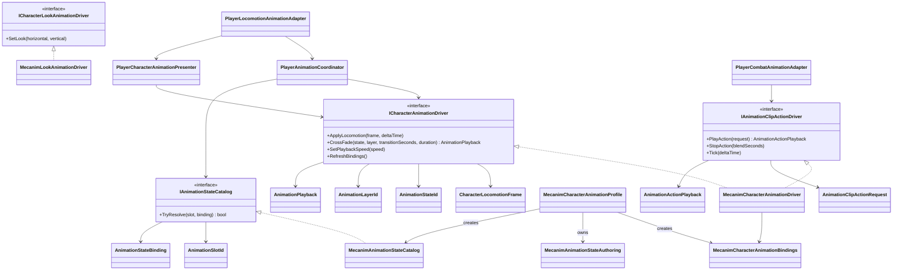

# Animation module

`ModularAnimation` defines a backend-neutral boundary for character animation.
Gameplay owns movement, combat transitions and action timing; an animation driver
only converts confirmed presentation data into poses and blends.

## Dependencies

- `ModularAnimation.Core` contains semantic values and the driver contract. It
  has no Unity dependency and does not reference Project S.
- `ModularAnimation.Unity` contains the Mecanim implementation. It depends only
  on `ModularAnimation.Core` and Unity animation APIs.
- Animator parameter names and semantic state mappings are supplied through
  `MecanimCharacterAnimationProfile`, which creates immutable
  parameter bindings and a state catalog; the module does not impose Project S
  controller names, layer indices or state paths. A character can use a
  different Animator Controller by assigning a matching profile. Look animation
  is a separate optional contract.
- `MecanimCharacterAnimationDriver` owns one `PlayableGraph`. An
  `AnimatorControllerPlayable` evaluates continuous Mecanim states, while two
  clip lanes evaluate full-body and AvatarMask actions. The same graph is the
  only pose source bound to the Animator.
- Mecanim state blends use `AnimatorControllerPlayable.CrossFadeInFixedTime`;
  profile transition values are seconds and therefore do not change meaning
  when clips are replaced.
- Finite actions use `AnimationClipPlayable` and do not require an Animator
  state, transition, trigger or clip-name placeholder. Two clip inputs allow a
  new action to interrupt and blend from the previous action.
- A null AvatarMask selects the full-body lane. A supplied mask selects the
  masked lane; switching between the lanes also blends through the graph.
- The driver owns its graph and runtime loadout controller and disposes both
  with the character scope. Action blend progression is ticked with the
  gameplay presentation delta time, so pause and hit stop remain explicit.
- The locomotion contract publishes `VerticalSpeed`. Animator transitions do
  not interpret that value as a timer or own the jump/fall gameplay decision.
- Discrete phases are selected through semantic slots, so the Mecanim contract
  does not require gameplay triggers or an `OnGround` transition parameter.
- `_App/Core` requests semantic states such as `Traversal.Ladder.Ascend` only
  for controller-backed presentation. Combat actions pass authored clips to the
  separate action driver and never resolve a placeholder Animator state.
- A mapping can be required or optional and can name another semantic slot as a
  fallback. Required mappings are resolved once at composition and fail fast;
  missing optional presentation never changes gameplay state.
- `ModularAnimation.Unity.Editor` validates the profile against an assigned
  Animator Controller and reports duplicate slots, missing layers/states,
  missing fallback slots, states without Motion and automatic transitions on
  layers declared as code-driven.
- `_App/Core -> ModularAnimation`; the module never references `_App/Core` or
  `_Game` assets.
- Project-specific source priorities and layer ownership live in
  `PlayerAnimationCoordinator` inside `_App/Core`; they are intentionally not
  part of the reusable module API.

## Ownership rules

- Gameplay state machines decide whether an action is allowed and when combat
  windows open or close.
- The driver may reject an invalid state or layer, but it never changes gameplay
  state.
- `AnimationPlayback.Duration` is explicit when gameplay supplies the active
  override clip duration, otherwise it comes from the character profile. The
  Mecanim adapter's clip-name inference is only a last fallback and is not the
  authoring contract.
- Animator parameters are private implementation details of the Mecanim driver.
- Root motion remains a gameplay/action policy. It is intentionally not stored
  in the animation profile, because changing presentation must not silently
  change movement simulation.
- Humanoid and Generic characters use the same driver contract. Retargeting and
  clip compatibility belong to each character's authoring profile/backend.

## Loadout overrides

`AnimatorOverrideController` remains an internal Mecanim detail only for
continuous loadout-dependent motions such as idle, run and roll. Combat,
weapon transitions and other finite actions never use it. This keeps existing
weapon locomotion authoring without reintroducing action states or controller
transition graphs.

## Extension

A third-party backend implements `ICharacterAnimationDriver` and, when it
supports finite clips, `IAnimationClipActionDriver`. Selection remains in the
composition root; gameplay timing and action graphs do not change.

## Current migration boundary

The player path uses this module for locomotion, camera look, dodge, combat and
ladder traversal. Combat clips run through the Playables action lanes; all other
semantic controller states remain code-driven. `PlayerLocomotionController` publishes one immutable
`PlayerLocomotionSnapshot`; the Project S presenter maps it into the module's
`CharacterLocomotionFrame`. Neither the presenter nor the driver reads
`Character` or input directly. Enemy migration remains a separate scope so the
animation boundary does not silently redesign enemy gameplay.
