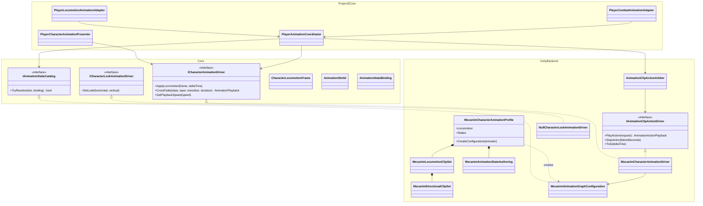
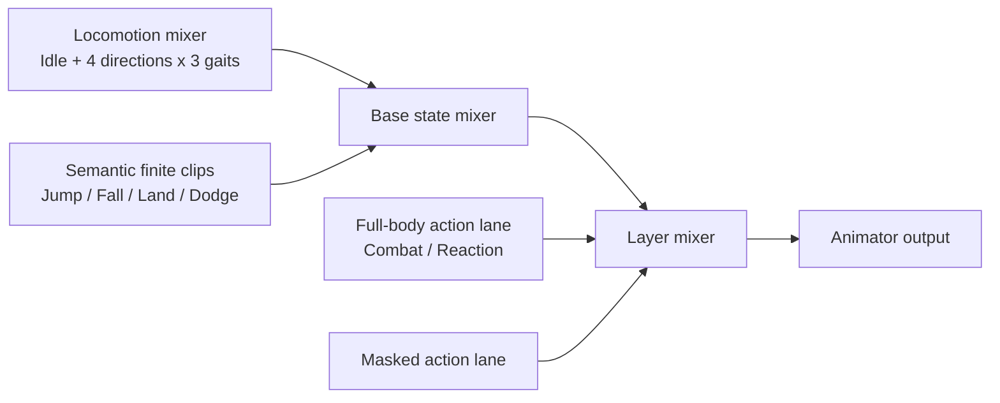

# Animation module

`ModularAnimation` is the backend-neutral presentation boundary for character
animation. Gameplay owns locomotion, combat phases, cancel windows and action
timing. The animation module receives confirmed semantic state and produces a
pose; it never decides whether an action is allowed.

The current Unity backend is fully code-driven. It does not require an Animator
Controller, Animator parameters, transitions, triggers or override controllers.

## Class tree and dependencies



Dependency direction remains:

```text
ProjectS.Core.Runtime -> ModularAnimation.Unity -> ModularAnimation.Core
```

Both module assemblies are independent of `_App/Core` and `_Game`. Project S
content enters only through the profile and composition root.

## Runtime graph

One `PlayableGraph` is the only pose source bound to the character Animator:



- Locomotion continuously blends idle, forward, backward, left and right clips
  for walk, run and sprint from `CharacterLocomotionFrame`.
- `MecanimLocomotionClipSet.BlendSeconds` controls a frame-rate-independent
  crossfade across every locomotion input. Direction reversals and gait changes
  preserve both outgoing and incoming weights during the blend instead of
  switching mixer inputs in one frame.
- Semantic slots resolve directly to either the locomotion graph or an authored
  finite clip. Transition values are seconds and are evaluated by code.
- Two finite-clip inputs permit interruption and crossfade without Animator
  states. Full-body and AvatarMask lanes remain isolated.
- `AnimationClipActionArbiter` is the single priority authority above action
  playback. Project S maps its policy
  `Death > Reaction > Traversal > Combat > Locomotion` in
  `PlayerAnimationCoordinator`; the reusable module sees numeric channels only.
- The driver owns and disposes the graph with the VContainer gameplay scope.
  It restores the Animator's previous controller reference on disposal.

## Generic and Humanoid rigs

The runtime algorithm is identical for both rig types. A profile must contain
only clips compatible with the assigned Avatar:

- Generic Animator + Generic clips from the same transform hierarchy;
- Humanoid Animator + Humanoid clips retargeted by Unity.

Compatibility is validated once when the gameplay scope is created. Mixed
Generic/Humanoid profiles, Legacy clips, invalid Avatars, duplicate semantic
slots and unresolved required slots fail fast. Changing rig family therefore
means assigning another Avatar/profile pair, not changing gameplay code.

The current player uses the PSO2 NGS male Generic Avatar. Humanoid adaptation is
a content migration: import a Humanoid model and clips, create a Humanoid
profile with the same semantic slots, then replace the prefab references.

## Ownership rules

- Animator is a presentation endpoint, never a gameplay state owner.
- Combat does not replace controllers or locomotion clips. It sends finite
  action requests through `PlayerAnimationCoordinator`.
- Root motion is selected by gameplay action policy and remains outside the
  animation profile. Presentation cannot silently move the character motor.
- Missing optional presentation may fall back to another semantic slot. It must
  not change gameplay state or combat results.
- Look animation remains a separate optional contract. The Generic PSO2 rig
  currently uses `NullCharacterLookAnimationDriver`; a future aim/look adapter
  can target rig transforms or Animation Rigging without changing this graph.
- Editor validation reports content-contract issues before Play Mode. Runtime
  validation repeats the rig-critical checks at composition.

## Extension boundary

A different animation technology implements `ICharacterAnimationDriver` and,
when it supports finite actions, `IAnimationClipActionDriver`. Selection belongs
only in the composition root. Input, locomotion state machines, combat graphs and
timings do not change with the backend.
