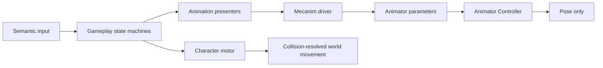

# Animation module

`ModularAnimation` is a small presentation boundary between gameplay and a
Unity Animator Controller. Gameplay owns movement, action eligibility, combat
timelines, cancel windows and damage. The Animator Controller owns clips,
blend trees and visual transitions.

No ScriptableObject animation graph, Playables graph or animation-derived
movement trajectory is used. The module supports both Generic and Humanoid
Avatars as long as the assigned clips are compatible with that Avatar.

## Class tree and dependencies


Dependency direction:

```text
ProjectS.Core.Runtime -> ModularAnimation.Unity -> ModularAnimation.Core
```

The module assemblies do not reference `_App/Core` or `_Game`. The Animator
Controller and content selection belong to Project S authoring.

## Runtime ownership



- `MecanimCharacterAnimationDriver` is the only runtime writer of Animator
  parameters.
- Locomotion is a continuous frame: normalized planar speed, vertical speed,
  grounded flag, gait and locomotion mode.
- Finite actions are semantic IDs plus a variant. The controller maps them to
  states through ordinary transitions.
- `PlayerAnimationCoordinator` arbitrates action priority
  (`Death > Reaction > Traversal > Combat > Locomotion`) but never chooses a
  clip.
- `Animator.applyRootMotion` is always disabled. Dodge and combat translation
  go through `CharacterMotor`, so collisions and grounding cannot be bypassed
  by presentation.
- Combat duration belongs to `CombatActionDefinition`; it is not inferred from
  an animation clip.

## Animator contract

The conventional controller must define these parameters:

| Parameter | Type | Meaning |
| --- | --- | --- |
| `MotionForward` | Float | normalized local forward direction |
| `MotionLateral` | Float | normalized local lateral direction |
| `MotionSpeed` | Float | planar speed in world units per second |
| `VerticalSpeed` | Float | vertical motor velocity |
| `Grounded` | Bool | confirmed motor grounding |
| `Gait` | Int | walk/run/sprint presentation hint |
| `LocomotionMode` | Int | grounded/airborne; other modes are reserved |
| `Action` | Trigger | start a semantic finite action |
| `ActionId` | Int | action family |
| `ActionVariant` | Int | direction or content variant |
| `CancelAction` | Trigger | return from an interruptible action |

The current Project S controller maps action `1` to forward/backward dodge and
action `2` to the first unarmed light attack. New combo steps will extend this
semantic mapping and the Animator graph together.

## Current scope

The KurtzPel player controller contains:

- idle/walk/run/sprint 1D locomotion blend tree;
- jump ascent, fall and landing states;
- forward and backward dodge;
- one grounded unarmed light attack;
- fixed-duration crossfades and explicit cancel transitions.

Swimming and ladder traversal animation are intentionally not implemented yet.
Their locomotion enum values remain reserved so adding presentation later does
not change the motor or public animation contract.

## Generic and Humanoid

The runtime contract is rig-independent. Today the Player prefab uses the
KurtzPel Generic Avatar and its 86-bone hierarchy. A later Humanoid migration
replaces the Avatar, clips and controller motions while preserving the same
parameters and semantic action IDs. Gameplay, input, combat timelines and the
motor do not change.
