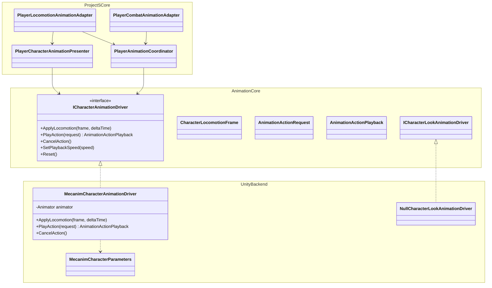
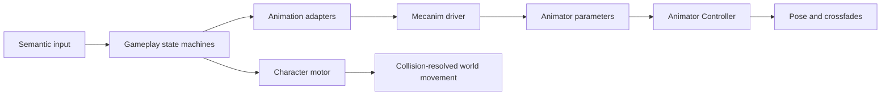

# Animation module

`ModularAnimation` is the rig-independent presentation boundary between
gameplay and a conventional Unity Animator Controller. Gameplay owns movement,
action eligibility, combat timelines, cancel windows, damage and
collision-resolved translation. The Animator owns clips, blend trees and pose
crossfades only.

The module does not contain Project S assets, clip names or a ScriptableObject
animation graph. Both Generic and Humanoid Avatars are supported when the
assigned controller and clips are compatible with the Avatar.

## Class tree and dependencies



Dependency direction:

```text
ProjectS.Core.Runtime -> ModularAnimation.Unity -> ModularAnimation.Core
```

The module assemblies do not reference `_App/Core` or `_Game`. Clip selection,
transition tuning and the Animator Controller asset belong to Project S.

## Runtime ownership



- `MecanimCharacterAnimationDriver` is the only runtime writer of Animator
  parameters.
- Locomotion remains continuous in gameplay. The driver also projects it onto
  the historical `XController` gait values for backward compatibility.
- Finite actions use semantic action IDs and variants. The Project S adapter
  maps them onto the authored controller contract; gameplay does not know
  state names or clips.
- `PlayerAnimationCoordinator` arbitrates action priority
  (`Death > Reaction > Traversal > Combat > Locomotion`) without choosing a
  clip.
- `Animator.applyRootMotion` is disabled. Dodge and combat translation pass
  through `CharacterMotor` and its collision/grounding rules.
- Combat duration belongs to gameplay authoring data; it is never inferred from
  clip length or Animator normalized time.

## Animator contract

Animator parameters are optional runtime outputs. The driver caches the
parameters present when it is created and writes only names whose types match;
missing parameters do not stop gameplay. This lets the controller graph,
states and transitions be authored incrementally without an editor generator.

The restored `XController.controller` uses the historical contract:

| Parameter | Type | Meaning |
| --- | --- | --- |
| `MovementType` | Float | `0` idle, `1` walk, `2` run, `3` sprint |
| `MovementDirection` | Float | signed normalized speed: backward `-1`, idle `0`, forward `1` |
| `FallingDuration` | Float | signed vertical velocity while airborne, otherwise `0` |
| `OnGround` | Bool | confirmed motor grounding |
| `SpeedMultiplier` | Float | presentation playback speed |

The driver also exposes a more detailed semantic contract for states and Blend
Trees added manually later:

| Parameter | Type | Meaning |
| --- | --- | --- |
| `PlanarSpeed` | Float | actual local planar speed in metres per second |
| `NormalizedSpeed` | Float | actual speed divided by the active gameplay maximum |
| `MoveX` | Float | normalized local lateral direction |
| `MoveY` | Float | normalized local forward direction |
| `VerticalSpeed` | Float | signed motor velocity along the character up axis |
| `Grounded` | Bool | confirmed motor grounding |
| `LocomotionPlaybackRate` | Float | optional locomotion state speed multiplier |
| `JumpStarting` | Bool | gameplay-owned jump anticipation window |
| `Action` | Trigger | starts a semantic finite action |
| `ActionId` | Int | action family |
| `ActionVariant` | Int | direction/content variant |
| `CancelAction` | Trigger | requests an interruptible action exit |

`PlanarSpeed` and `NormalizedSpeed` are damped over `0.18 s`; direction over
`0.08 s`; vertical velocity over `0.04 s`. The longer speed filter keeps an
abrupt motor stop from crossing the walk/run blend in a single rendered frame.
These presentation filters do not delay gameplay state or motor response.

## Project S controller policy

`XController.controller` is an ordinary manually authored Animator Controller.
Runtime code never creates states, assigns clips, edits Blend Trees or installs
transitions. The Player prefab only assigns this controller and disables root
motion.

The restored controller has no `Action`, `ActionId`, `ActionVariant` or
`CancelAction` parameters and no entry transitions into its existing Roll and
Attack sub-state machines. `XControllerCharacterAnimationDriver` therefore
crossfades semantic dodge and light-attack requests into those already-authored
states. Their clips, hierarchy and exit transitions remain owned by the
controller asset.

## Generic and Humanoid

The current Player scene uses a valid Humanoid Avatar from the CLazy T-pose
source. The reusable module still accepts either Generic or Humanoid animation
backends; the Project S `XController` adapter intentionally validates Humanoid
because the restored controller clips are authored for that retargeting path.
