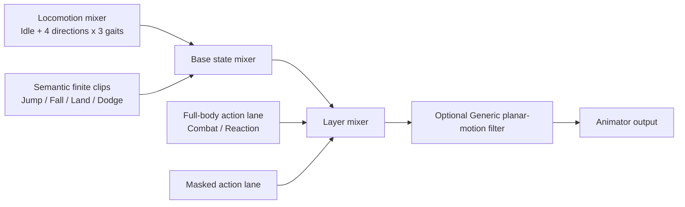
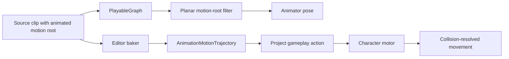

# Animation module

`ModularAnimation` is the backend-neutral presentation boundary for character
animation. Gameplay owns locomotion, combat phases, cancel windows and action
timing. The animation module receives confirmed semantic state and produces a
pose; it never decides whether an action is allowed.

The current Unity backend is fully code-driven. It does not require an Animator
Controller, Animator parameters, transitions, triggers or override controllers.

## Class tree and dependencies

```mermaid
classDiagram
    namespace Core {
        class ICharacterAnimationDriver {
            <<interface>>
            +ApplyLocomotion(frame, deltaTime)
            +CrossFade(state, layer, transition, duration) AnimationPlayback
            +SetPlaybackSpeed(speed)
        }
        class IAnimationStateCatalog {
            <<interface>>
            +TryResolve(slot, binding) bool
        }
        class ICharacterLookAnimationDriver {
            <<interface>>
            +SetLook(horizontal, vertical)
        }
        class CharacterLocomotionFrame
        class AnimationSlotId
        class AnimationStateBinding
    }

    namespace UnityBackend {
        class MecanimCharacterAnimationProfile {
            +Locomotion
            +States
            +CreateConfiguration(animator)
        }
        class MecanimLocomotionClipSet
        class MecanimDirectionalClipSet
        class MecanimAnimationStateAuthoring
        class MecanimAnimationGraphConfiguration
        class MecanimCharacterAnimationDriver
        class MecanimPlanarMotionFilterJob
        class IAnimationClipActionDriver {
            <<interface>>
            +PlayAction(request) AnimationActionPlayback
            +StopAction(blendSeconds)
            +Tick(deltaTime)
        }
        class AnimationClipActionArbiter
        class NullCharacterLookAnimationDriver
        class AnimationMotionTrajectory {
            +EvaluatePosition(normalizedTime)
            +EvaluateRotation(normalizedTime)
        }
    }

    namespace UnityEditorBackend {
        class AnimationMotionTrajectoryBaker {
            +Bake(request) AnimationMotionTrajectory
        }
    }

    namespace ProjectSCore {
        class PlayerAnimationCoordinator
        class PlayerCharacterAnimationPresenter
        class PlayerLocomotionAnimationAdapter
        class PlayerCombatAnimationAdapter
    }

    ICharacterAnimationDriver <|.. MecanimCharacterAnimationDriver
    IAnimationClipActionDriver <|.. MecanimCharacterAnimationDriver
    IAnimationStateCatalog <|.. MecanimAnimationGraphConfiguration
    ICharacterLookAnimationDriver <|.. NullCharacterLookAnimationDriver

    MecanimCharacterAnimationProfile *-- MecanimLocomotionClipSet
    MecanimLocomotionClipSet *-- MecanimDirectionalClipSet
    MecanimCharacterAnimationProfile *-- MecanimAnimationStateAuthoring
    MecanimCharacterAnimationProfile ..> MecanimAnimationGraphConfiguration : creates
    MecanimCharacterAnimationDriver --> MecanimAnimationGraphConfiguration
    MecanimCharacterAnimationDriver --> MecanimPlanarMotionFilterJob
    AnimationClipActionArbiter --> IAnimationClipActionDriver
    AnimationMotionTrajectoryBaker ..> AnimationMotionTrajectory : creates

    PlayerCharacterAnimationPresenter --> ICharacterAnimationDriver
    PlayerLocomotionAnimationAdapter --> PlayerAnimationCoordinator
    PlayerCombatAnimationAdapter --> PlayerAnimationCoordinator
    PlayerAnimationCoordinator --> ICharacterAnimationDriver
    PlayerAnimationCoordinator --> IAnimationStateCatalog
    PlayerAnimationCoordinator --> AnimationClipActionArbiter
```



Dependency direction remains:

```text
ProjectS.Core.Runtime -> ModularAnimation.Unity -> ModularAnimation.Core
```

Both module assemblies are independent of `_App/Core` and `_Game`. Project S
content enters only through the profile and composition root.

## Runtime graph

One `PlayableGraph` is the only pose source bound to the character Animator:



- Locomotion continuously blends idle, forward, backward, left and right clips
  for walk, run and sprint from `CharacterLocomotionFrame`.
- `MecanimLocomotionClipSet.BlendSeconds` controls a frame-rate-independent
  crossfade across every locomotion input. Direction reversals and gait changes
  preserve both outgoing and incoming weights during the blend instead of
  switching mixer inputs in one frame.
- Semantic slots resolve directly to either the locomotion graph or an authored
  finite clip. Transition values are seconds and are evaluated by code.
- Two finite-clip inputs permit interruption and crossfade without Animator
  states. Full-body and AvatarMask lanes remain isolated.
- `AnimationClipActionArbiter` is the single priority authority above action
  playback. Project S maps its policy
  `Death > Reaction > Traversal > Combat > Locomotion` in
  `PlayerAnimationCoordinator`; the reusable module sees numeric channels only.
- The driver owns and disposes the graph with the VContainer gameplay scope.
  It restores the Animator's previous controller reference on disposal.
- A configured Generic motion-root path adds one stream job after the layer
  mixer. It fixes only that bone's local X/Z pose and does not duplicate or
  mutate source clips.

## Generic and Humanoid rigs

The runtime algorithm is identical for both rig types. A profile must contain
only clips compatible with the assigned Avatar:

- Generic Animator + Generic clips from the same transform hierarchy;
- Humanoid Animator + Humanoid clips retargeted by Unity.

Compatibility is validated once when the gameplay scope is created. Mixed
Generic/Humanoid profiles, Legacy clips, invalid Avatars, duplicate semantic
slots and unresolved required slots fail fast. Changing rig family therefore
means assigning another Avatar/profile pair, not changing gameplay code.

The current player uses the PSO2 NGS male Generic Avatar. Humanoid adaptation is
a content migration: import a Humanoid model and clips, create a Humanoid
profile with the same semantic slots, then replace the prefab references.

## Ownership rules

- Animator is a presentation endpoint, never a gameplay state owner.
- Combat does not replace controllers or locomotion clips. It sends finite
  action requests through `PlayerAnimationCoordinator`.
- Animator root motion is always disabled by the runtime driver. Presentation
  cannot silently move the character transform or motor.
- Animation-authored displacement is baked in the Editor into an
  `AnimationMotionTrajectory`. For Generic content, an optional Playables stream
  job removes planar translation from the rendered motion-root pose without
  creating a duplicate clip. Gameplay decides whether and how to consume the
  trajectory.
- Missing optional presentation may fall back to another semantic slot. It must
  not change gameplay state or combat results.
- Look animation remains a separate optional contract. The Generic PSO2 rig
  currently uses `NullCharacterLookAnimationDriver`; a future aim/look adapter
  can target rig transforms or Animation Rigging without changing this graph.
- Editor validation reports content-contract issues before Play Mode. Runtime
  validation repeats the rig-critical checks at composition.

## Extension boundary

A different animation technology implements `ICharacterAnimationDriver` and,
when it supports finite actions, `IAnimationClipActionDriver`. Selection belongs
only in the composition root. Input, locomotion state machines, combat graphs and
timings do not change with the backend.

## Motor-authoritative animation motion

The runtime never applies `Animator.deltaPosition` or `Animator.deltaRotation`
to a character. This avoids frame/update-order dependence and prevents an
animation from bypassing the character collision sweep.



`AnimationMotionTrajectory` stores sampled displacement and rotation in a
canonical character-local coordinate system. Sampling is allocation-free.
Source-specific axis conversion and unit scale belong to the Editor bake
request, so the runtime representation is identical for Generic and Humanoid
content.

Project S currently bakes PSO2 NGS motion from `pl_rbd_100000_bw`, converts the
visual rig's 180-degree yaw and 0.6 scale into character-local space, and gives
the resulting trajectory to combat or dodge gameplay. Combat targeting may
rotate the local trajectory toward the current target, while
`CharacterMovement` remains the only collision and grounding authority. Combat
consumes position deltas between timeline samples rather than an instantaneous
sample velocity, so a frame hitch does not silently discard authored travel.
The original Generic clip remains the presentation source; the graph filters
`pl_rbd_100000_bw` in memory instead of committing large in-place clip copies.
