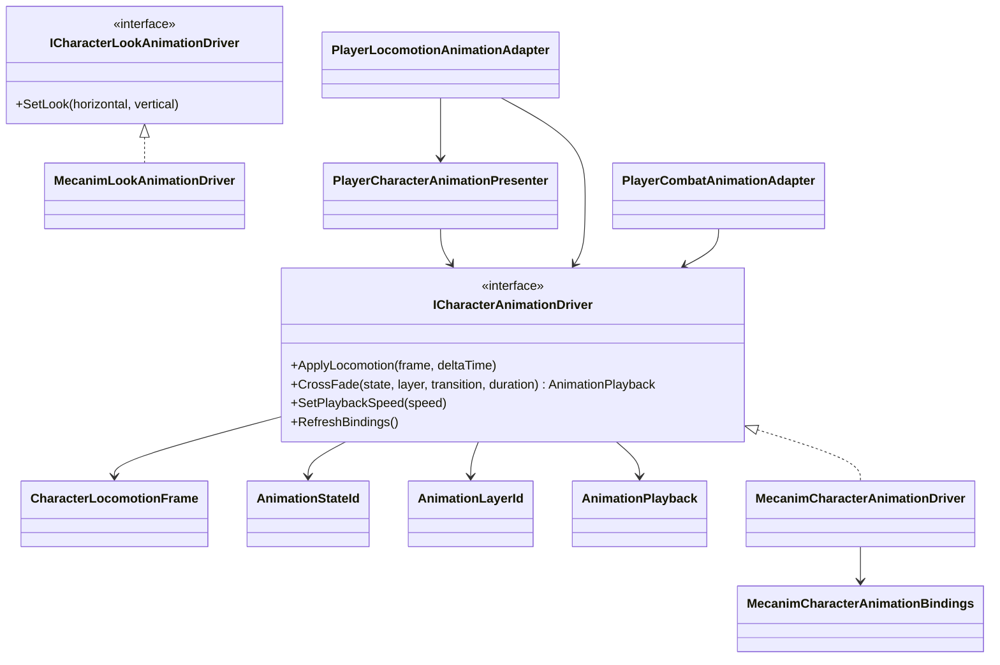

# Animation module

`ModularAnimation` defines a backend-neutral boundary for character animation.
Gameplay owns movement, combat transitions and action timing; an animation driver
only converts confirmed presentation data into poses and blends.

## Dependencies

- `ModularAnimation.Core` contains semantic values and the driver contract. It
  has no Unity dependency and does not reference Project S.
- `ModularAnimation.Unity` contains the Mecanim implementation. It depends only
  on `ModularAnimation.Core` and Unity animation APIs.
- Animator parameter names are supplied through
  `MecanimCharacterAnimationBindings`; the module does not impose Project S
  controller names. Look animation is a separate optional contract.
- Project-specific state names, locomotion sampling and combat clip selection
  remain in `_App/Core`.
- `_App/Core -> ModularAnimation`; the module never references `_App/Core` or
  `_Game` assets.

## Ownership rules

- Gameplay state machines decide whether an action is allowed and when combat
  windows open or close.
- The driver may reject an invalid state or layer, but it never changes gameplay
  state.
- `AnimationPlayback.Duration` is explicit when the caller supplies it. The
  Mecanim adapter can infer it only when a state and clip share a name; callers
  that own gameplay timing must verify a positive duration.
- Animator parameters are private implementation details of the Mecanim driver.
- Root motion is opt-in through `RootMotionPolicy`; in-place locomotion uses
  `Ignore`.
- Humanoid and Generic characters use the same driver contract. Retargeting and
  clip compatibility belong to each character's authoring profile/backend.

## Extension

A Playables or third-party backend implements `ICharacterAnimationDriver` and
is selected in the composition root. Gameplay presenters and controllers do not
change when the backend changes.

## Current migration boundary

The player path uses this module for locomotion, camera look, dodge, combat and
ladder traversal. The old Project S `AnimationController` remains only on the
legacy enemy path; new player code must not depend on it. Enemy migration is a
separate scope so this refactor does not silently redesign enemy gameplay.
