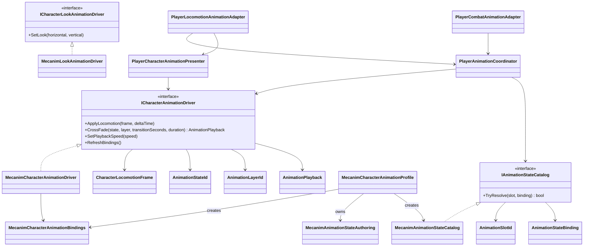

# Animation module

`ModularAnimation` defines a backend-neutral boundary for character animation.
Gameplay owns movement, combat transitions and action timing; an animation driver
only converts confirmed presentation data into poses and blends.

## Dependencies

- `ModularAnimation.Core` contains semantic values and the driver contract. It
  has no Unity dependency and does not reference Project S.
- `ModularAnimation.Unity` contains the Mecanim implementation. It depends only
  on `ModularAnimation.Core` and Unity animation APIs.
- Animator parameter names and semantic state mappings are supplied through
  `MecanimCharacterAnimationProfile`, which creates immutable
  parameter bindings and a state catalog; the module does not impose Project S
  controller names, layer indices or state paths. A character can use a
  different Animator Controller by assigning a matching profile. Look animation
  is a separate optional contract.
- Mecanim blends use `CrossFadeInFixedTime`; profile transition values are
  seconds and therefore do not change meaning when clips are replaced.
- The locomotion contract publishes `VerticalSpeed`. Animator transitions do
  not interpret that value as a timer or own the jump/fall gameplay decision.
- Discrete phases are selected through semantic slots, so the Mecanim contract
  does not require gameplay triggers or an `OnGround` transition parameter.
- `_App/Core` requests semantic slots such as `Combat.Combo.0` and
  `Traversal.Ladder.Ascend`. Only the character profile knows that these resolve
  to concrete Mecanim layers and nested state paths.
- A mapping can be required or optional and can name another semantic slot as a
  fallback. Required mappings are resolved once at composition and fail fast;
  missing optional presentation never changes gameplay state.
- `ModularAnimation.Unity.Editor` validates the profile against an assigned
  Animator Controller and reports duplicate slots, missing layers/states,
  missing fallback slots, states without Motion and automatic transitions on
  layers declared as code-driven.
- `_App/Core -> ModularAnimation`; the module never references `_App/Core` or
  `_Game` assets.
- Project-specific source priorities and layer ownership live in
  `PlayerAnimationCoordinator` inside `_App/Core`; they are intentionally not
  part of the reusable module API.

## Ownership rules

- Gameplay state machines decide whether an action is allowed and when combat
  windows open or close.
- The driver may reject an invalid state or layer, but it never changes gameplay
  state.
- `AnimationPlayback.Duration` is explicit when gameplay supplies the active
  override clip duration, otherwise it comes from the character profile. The
  Mecanim adapter's clip-name inference is only a last fallback and is not the
  authoring contract.
- Animator parameters are private implementation details of the Mecanim driver.
- Root motion remains a gameplay/action policy. It is intentionally not stored
  in the animation profile, because changing presentation must not silently
  change movement simulation.
- Humanoid and Generic characters use the same driver contract. Retargeting and
  clip compatibility belong to each character's authoring profile/backend.

## Extension

A Playables or third-party backend implements `ICharacterAnimationDriver` and
is selected in the composition root. Gameplay presenters and controllers do not
change when the backend changes.

## Current migration boundary

The player path uses this module for locomotion, camera look, dodge, combat and
ladder traversal. `PlayerLocomotionController` publishes one immutable
`PlayerLocomotionSnapshot`; the Project S presenter maps it into the module's
`CharacterLocomotionFrame`. Neither the presenter nor the driver reads
`Character` or input directly. Enemy migration remains a separate scope so the
animation boundary does not silently redesign enemy gameplay.
