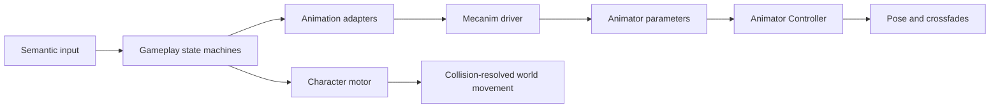

# Animation module

`ModularAnimation` is the rig-independent presentation boundary between
gameplay and a conventional Unity Animator Controller. Gameplay owns movement,
action eligibility, combat timelines, cancel windows, damage and
collision-resolved translation. The Animator owns clips, blend trees and pose
crossfades only.

The module does not contain Project S assets, clip names or a ScriptableObject
animation graph. Both Generic and Humanoid Avatars are supported when the
assigned controller and clips are compatible with the Avatar.

## Class tree and dependencies


Dependency direction:

```text
ProjectS.Core.Runtime -> ModularAnimation.Unity -> ModularAnimation.Core
```

The module assemblies do not reference `_App/Core` or `_Game`. Clip selection,
transition tuning and the Animator Controller asset belong to Project S.

## Runtime ownership



- `MecanimCharacterAnimationDriver` is the only runtime writer of Animator
  parameters.
- Locomotion is continuous. The driver does not convert speed into a discrete
  idle/walk/run enum.
- Finite actions use semantic action IDs and variants. Project S maps those
  values to ordinary Animator transitions.
- `PlayerAnimationCoordinator` arbitrates action priority
  (`Death > Reaction > Traversal > Combat > Locomotion`) without choosing a
  clip.
- `Animator.applyRootMotion` is disabled. Dodge and combat translation pass
  through `CharacterMotor` and its collision/grounding rules.
- Combat duration belongs to gameplay authoring data; it is never inferred from
  clip length or Animator normalized time.

## Animator contract

Every compatible controller defines these parameters:

| Parameter | Type | Meaning |
| --- | --- | --- |
| `PlanarSpeed` | Float | actual local planar speed in metres per second |
| `NormalizedSpeed` | Float | actual speed divided by the active gameplay maximum |
| `MoveX` | Float | normalized local lateral direction |
| `MoveY` | Float | normalized local forward direction |
| `VerticalSpeed` | Float | signed motor velocity along the character up axis |
| `Grounded` | Bool | confirmed motor grounding |
| `LocomotionPlaybackRate` | Float | optional locomotion state speed multiplier |
| `JumpStarting` | Bool | gameplay-owned jump anticipation window |
| `Action` | Trigger | starts a semantic finite action |
| `ActionId` | Int | action family |
| `ActionVariant` | Int | direction/content variant |
| `CancelAction` | Trigger | requests an interruptible action exit |

`PlanarSpeed` and `NormalizedSpeed` are damped over `0.06 s`; direction over
`0.08 s`; vertical velocity over `0.04 s`. These short presentation filters do
not delay gameplay state or motor response.

The old `MovementType`, `MovementDirection`, `FallingDuration` and `OnGround`
names remain constants only for imported/reference controllers. They are not
written by the Project S player driver.

## Project S controller policy

`PlayerKurtzPel.controller` is a normal, editable Animator Controller with one
layer and Write Defaults disabled on every state. Its builder creates it only
when it is missing; later manual Animator edits are validated and preserved.

- Idle is separate from the locomotion Blend Tree so movement never starts at
  an arbitrary shared phase.
- The locomotion tree contains only compatible cyclic walk/run/sprint clips and
  uses physical thresholds `3 / 5 / 10 m/s`.
- Idle/move use `0.10 / 0.14 m/s` hysteresis and `0.12 s` crossfades.
- Walk is the phase reference. Run and sprint cycle offsets align their first
  measured foot contacts to it.
- Jump anticipation, rise, fall and landing are separate states driven by
  gameplay grounding/velocity rather than clip completion alone.
- Action entry is `0.055 s`; dodge exit is `0.08 s`; attack exit is `0.12 s`.
  Dodge playback speed is fitted to the motor-owned `0.48 s` dodge window.

The current semantic map uses action `1` for forward/backward dodge and action
`2` for the first unarmed light attack. Combo expansion adds ordinary Animator
states/transitions and gameplay timelines; it does not add another animation
graph abstraction.

## Generic and Humanoid

The Player currently uses the KurtzPel Generic Avatar because the model and all
437 clips share the exact source skeleton, including weapon/twist bones. A
temporary Humanoid import probe produced a valid Human Avatar with 52 mapped
human bones, so later migration is feasible.

Migration should happen when the production Humanoid character exists. Doing it
now would add retargeting differences without providing a runtime benefit. The
module contracts, gameplay state machines, motor and semantic action IDs remain
unchanged during that content migration.
