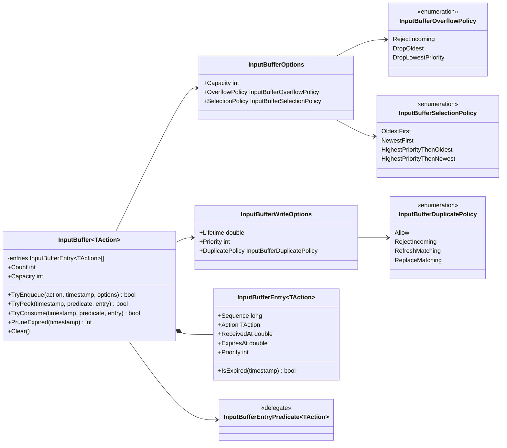

# Input buffering core

`InputBuffer<TAction>` — независимая от Unity очередь семантических действий.
Она не знает про устройства, `InputAction`, персонажа, combat state, Animator или
жанр игры. Время передаёт consumer, поэтому один и тот же тип можно использовать
с unscaled, scaled, simulation или network clock.

## Дерево классов

## Ответственность и зависимости

- `InputBuffer<TAction>` владеет только ожидающими действиями и их удалением.
- Consumer владеет смыслом `TAction`, выбранным clock и правилами допустимости.
- `InputBufferOptions` задаёт форму очереди: ёмкость, overflow и порядок выбора.
- `InputBufferWriteOptions` задаётся для каждого действия отдельно: lifetime,
  priority и обработка повторов.
- Predicate фильтрует допустимые сейчас действия, после чего selection policy
  выбирает одно из них. Недопустимая команда не блокирует более позднюю
  допустимую команду.
- Все entries хранятся в массиве фиксированной ёмкости. После construction
  enqueue/peek/consume не создают коллекций и не увеличивают память.

Модуль сознательно не содержит `HackAndSlashInputBuffer`,
`SoulsLikeInputBuffer` или `ActionRpgInputBuffer`. Жанр возникает из сочетания
конфигурации очереди и правил state machine, а не из наследования инфраструктуры.

## Семантика политик

- `RejectIncoming` сохраняет уже накопленный ввод.
- `DropOldest` освобождает место за счёт самой ранней команды.
- `DropLowestPriority` отклоняет входящую команду, если её priority ниже всех
  накопленных; иначе вытесняет самую низкоприоритетную, при равенстве — старую.
- `Allow` разрешает несколько одинаковых нажатий.
- `RefreshMatching` обновляет lifetime/priority одной совпавшей команды без
  создания ещё одного элемента.
- `ReplaceMatching` удаляет все совпавшие команды и записывает новую.

Expiration проверяется относительно переданного timestamp. Entry остаётся
действительным в точке `timestamp == ExpiresAt` и удаляется после неё.
