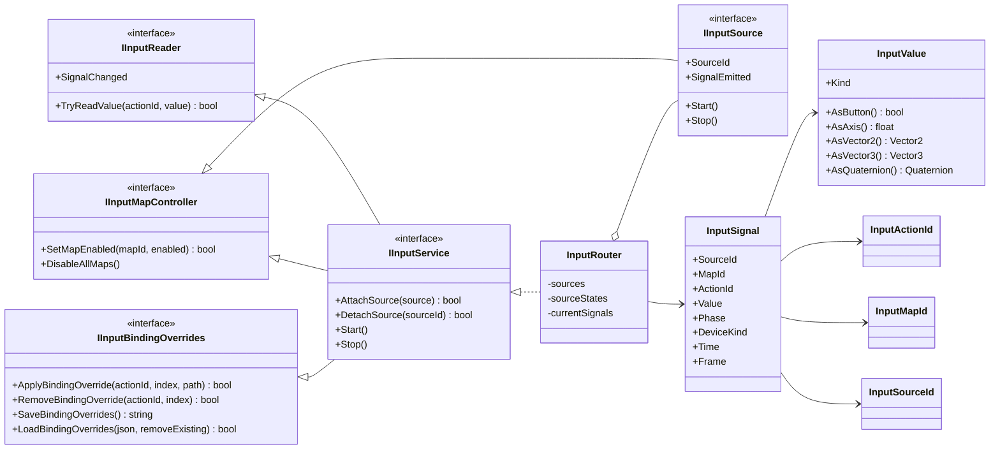
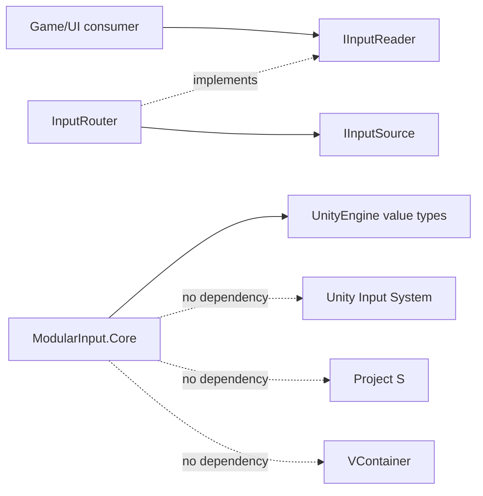

# Modular Input — Core

## Ответственность

Core определяет язык ввода, независимый от конкретного SDK: стабильные идентификаторы action/map, типизированное значение, фазу, источник и устройство. Он маршрутизирует несколько источников и оставляет активным последнее актуальное значение каждого action.

Core не знает о `InputActionAsset`, Player, UI, DI container, сохранениях или конкретных control paths.

## Дерево классов

## Зависимости

- `InputActionId` и `InputMapId` используют GUID. Переименование action/map в authoring asset не ломает потребителя.
- `InputSignal` — завершённый факт от источника; он содержит время и кадр, поэтому combat buffer не обязан угадывать порядок `Update`.
- `InputRouter` является владельцем подписок на sources и очищает их при `Stop`/`Dispose`.
- Несколько источников можно подключать динамически. Для одного action побеждает последний активный source; отмена одного source восстанавливает ещё активный сигнал другого.
- Binding persistence наружу представлен строкой JSON. Где и как её хранить, решает Save-модуль; Input не зависит от него.

## Правила расширения

- Новый backend реализует `IInputSource`; Core менять не нужно.
- Новый тип gameplay-команды создаётся в адаптере конкретной игры, а не в Core.
- Новый action не требует нового класса в модуле: source публикует его GUID автоматически.
- Новая политика объединения источников добавляется отдельной реализацией `IInputService`, не условными ветками внутри gameplay.
