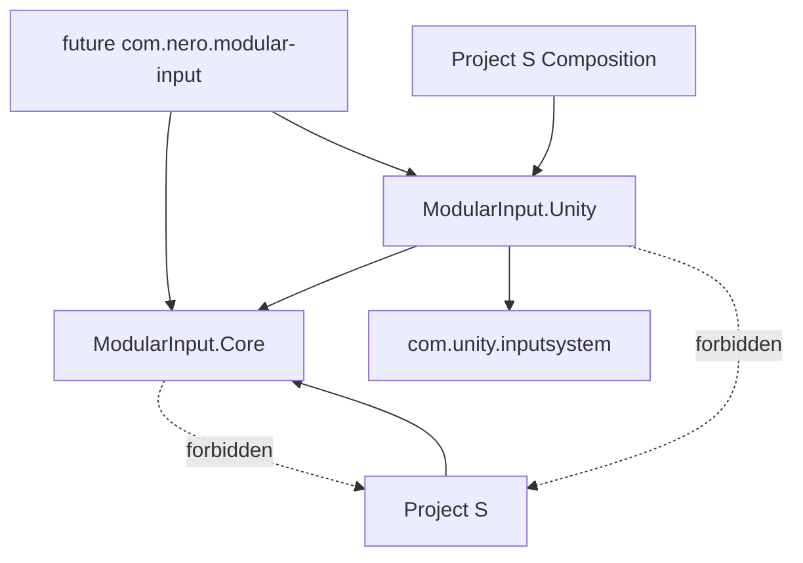

# Modular Input — граница пакета

## Текущая структура

```text
Input/
├── Runtime/
│   ├── Core/                   # ModularInput.Core.asmdef
│   └── Unity/                  # ModularInput.Unity.asmdef
├── Documentation~/
└── README.md
```

Директория уже соответствует package-friendly layout. Runtime разделён assembly definitions, поэтому Unity проверяет направление зависимостей сейчас, до физического переноса в `Packages`.

## Публичная граница



Единственная внешняя package dependency — `com.unity.inputsystem`. VContainer остаётся деталью композиции проекта и не попадёт в package manifest.

UPM-перенос не должен менять namespaces или public API: корень `Assets/_App/Modules/Input` переносится как package root, после чего добавляется `package.json`. До стабилизации реального использования package versioning не вводится.

## Критерии независимости

- отсутствуют ссылки на `_App` и `_Game`;
- отсутствуют scene/prefab references;
- action asset передаётся снаружи;
- source и router имеют явный lifecycle и `Dispose`;
- конфигурация Project S и семантические player-команды находятся за пределами модуля.
